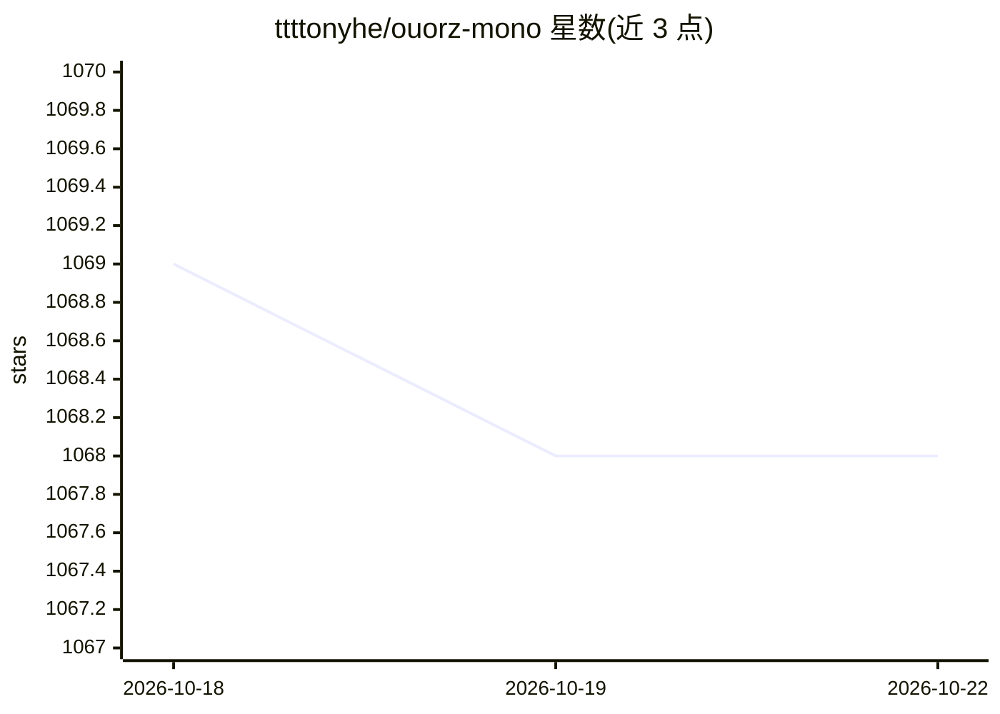

# ttttonyhe/ouorz-mono

⭐ 1,068 · TypeScript · GPL-3.0 · 推送 2026-10-18 · [GitHub](https://github.com/ttttonyhe/ouorz-mono) · [官网](https://lipeng.ac) · 个人维护 · 中文 README

**个人网站与学术主页的 monorepo（前端+WordPress+统计）**

作者个人网站 lipeng.ac 及相关项目的 monorepo 源码与 Docker 镜像。主应用基于 React/Next.js，含 SSR/SSG/按需 ISR、命令面板、Redux 状态管理与暗色模式；另含容器化的 headless WordPress（作为 CMS）、基于 Umami 的分析应用、Twilight 前端组件库。以 Bun workspaces + Turborepo 管理，提供 Docker、Fly.io、Vercel/Netlify 部署说明。README 未展示 AI 功能，仅仓库主题标签含 openai-api。

## 筛选速览

| 维度 | 判定 | 备注 |
|---|---|---|
| AI 角色 | `ai-enhanced` | 去掉 AI 部分产品仍成立 |
| 许可风险 | `viral` | GPL-3.0 |
| 部署形态 | `self-host` | docker 或自建部署 |
| 模型依赖 | — | README 未给出锁定关系 |
| 硬件要求 | — | 无带数字的原话,不猜 |
| 安装摩擦 | `low` | 无编译、无系统依赖或容器化 |
| 成熟度 | `idea` | |

## 能力要点

- Next.js 主应用支持 SSR/SSG/按需 ISR 与命令面板
- WordPress 以 Docker 容器形式作为 headless CMS
- 内置基于 Umami 的网站分析应用与 Twilight UI 组件库
- Bun workspaces + Turborepo monorepo 工程化

## 适用场景

- 自部署同构个人博客/学术主页
- 以 headless WordPress 方案管理站点内容
- 参考 Next.js + Turborepo 的 monorepo 工程实践

## 场景标签

 · 领域:Web/个人网站

## 证据(README 行号)

> L2:  Source code & Docker image that power lipeng.ac and other related projects
> L26: - SSR/SSG/On-demand ISR

## 星数曲线

2026-10-18 1,069 → 2026-10-22 1,068（-1）

---
*卡片 v1 · prompt 1.4 · 生成 2026-10-21 · 置信度 low · 依据 README sha `52cab512a480` · [字段定义](../../DATASET.md)*
