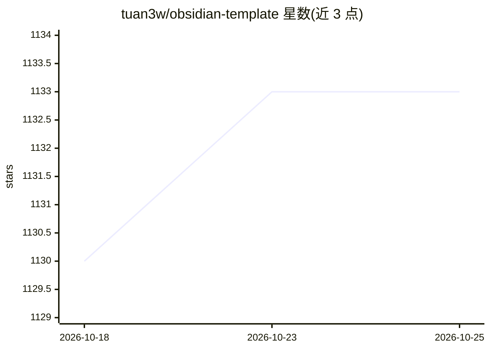

# tuan3w/obsidian-template

⭐ 1,135 · Python · MIT · 推送 2026-03-21 · [GitHub](https://github.com/tuan3w/obsidian-template) · 个人维护

**Obsidian 第二大脑起步模板：笔记模板+插件+Zettelkasten 工作流**

个人维护的 Obsidian vault 起步模板：内置 Term/Resource/Book/Quote 等 Zettelkasten 风格笔记模板、Obsidian minimal 主题、约 20 个推荐插件（含 Kanban 阅读追踪、Spaced Repetition 制 Anki 卡、Dataview 自动汇总、Khoj AI 对知识库搜索问答），并附网页剪藏模板与统计脚本。面向用 Obsidian 搭建第二大脑的学习者。README 顶部声明已停止积极维护，作者转向基于 Claude Code 的 vault agent 方案。

## 筛选速览

| 维度 | 判定 | 备注 |
|---|---|---|
| AI 角色 | `ai-enhanced` | 去掉 AI 部分产品仍成立 |
| 许可风险 | `permissive` | MIT |
| 部署形态 | `None` |  |
| 模型依赖 | — | README 未给出锁定关系 |
| 硬件要求 | — | 无带数字的原话,不猜 |
| 安装摩擦 | `low` | 无编译、无系统依赖或容器化 |
| 成熟度 | — | 结构信号不足 |

## 能力要点

- 多种 Zettelkasten 风格笔记模板与 unique ID 生成
- 约 20 个推荐插件清单（Kanban、Spaced Repetition、Dataview、Khoj 等）
- web clipper 模板，可配合 LLM 自动摘要与生成标签
- update 脚本自动统计笔记数量并生成进度图

## 适用场景

- 用 Obsidian 搭建个人第二大脑与阅读追踪
- 按间隔重复方式复习笔记并制作 Anki 卡片
- 用 Khoj 对个人文档进行搜索与问答
- 剪藏网页内容供日后复习

## 场景标签

`知识库管理` · 领域:知识与检索

## 证据(README 行号)

> L3: > **Note:** This template is no longer actively maintained. Things are changing — I now believe Claude Code is all y
> L47: - Khoj: An AI copilot for your second brain. Search and chat with your personal knowledge base, online or offline.
> L115: You can import these templates through the Obsidian Web Clipper extension settings. Additionally, you can leverage

## 星数曲线

2026-10-18 1,130 → 2026-10-25 1,133（+3）

---
*卡片 v1 · prompt 1.4 · 生成 2026-10-21 · 置信度 high · 依据 README sha `2b1c02b36f00` · [字段定义](../../DATASET.md)*
