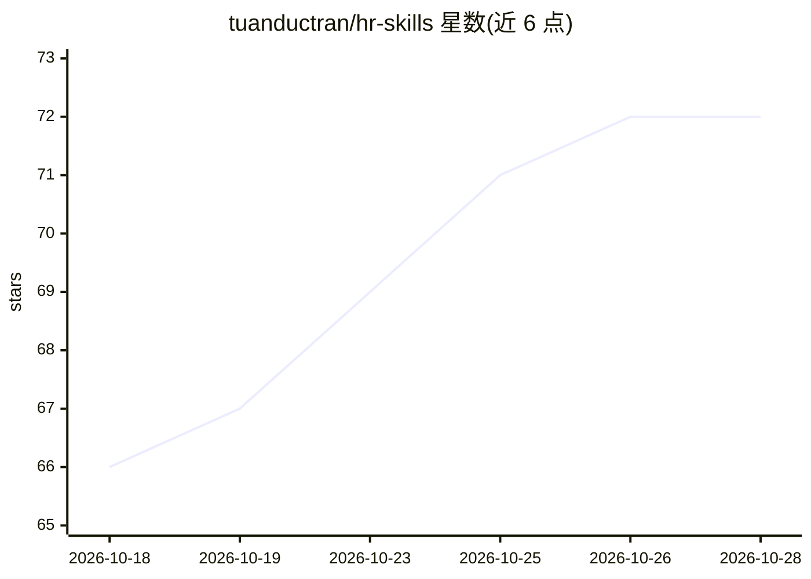

# tuanductran/hr-skills

⭐ 72 · TypeScript · MIT · 推送 2026-10-22 · [GitHub](https://github.com/tuanductran/hr-skills) · [官网](https://hr-skills-web.vercel.app) · 个人维护

**面向 HR 从业者的 Agent Skills 知识库，覆盖招聘到留任全周期**

遵循开放 Agent Skills 规范的人力资源技能库：每个技能由 SKILL.md、content/、prompts/、examples/ 组成，作为可复用提示包扩展 AI 助手的领域能力。内容覆盖人才招聘、入离职、绩效、薪酬、HR 分析、AI 治理、越南劳动法等职能域。安装方式为复制 skills 目录到 Claude Code 或上传 SKILL.md 到 Claude.ai Project Knowledge，也可通过 npx/bunx 命令行包使用；仓库以 Bun + Turborepo monorepo 构建。

## 筛选速览

| 维度 | 判定 | 备注 |
|---|---|---|
| AI 角色 | `ai-knowledge` | 知识聚合/清单类 |
| 许可风险 | `permissive` | MIT |
| 部署形态 | `library` | 以包/库形式分发 |
| 模型依赖 | — | README 未给出锁定关系 |
| 硬件要求 | — | 无带数字的原话,不猜 |
| 安装摩擦 | `low` | 无编译、无系统依赖或容器化 |
| 成熟度 | — | 结构信号不足 |

## 能力要点

- 每个技能含 SKILL.md 定义、领域知识、提示模板与示例四部分
- 覆盖核心 HR 职能、战略分析、HR 技术与 AI、专门领域四类内容
- 提供 npx/bunx 命令行包与 Skill Planner/Workflow Runtime 编程化驱动
- 含技能矩阵文档跟踪覆盖度与成熟度

## 适用场景

- 让 Claude 等 AI 助手按 HR 领域规范执行招聘、绩效、入职等任务
- 组合多个技能支撑招聘到继任的完整工作流
- 查阅 HR 技能清单了解覆盖范围与成熟度

## 场景标签

`提示工程` · 领域:Agent 开发

## 证据(README 行号)

> L3: A comprehensive library of domain-specific Agent Skills for Human Resources professionals, designed for AI-powered H
> L9: HR Skills follows the open **Agent Skills** specification and provides structured, reusable building blocks that hel
> L123: Agent Skills are reusable prompt packages that extend AI assistants with specialized domain expertise.

## 星数曲线

2026-10-18 66 → 2026-10-28 72（+6）

---
*卡片 v1 · prompt 1.4 · 生成 2026-10-24 · 置信度 high · 依据 README sha `54b60458665c` · [字段定义](../../DATASET.md)*
