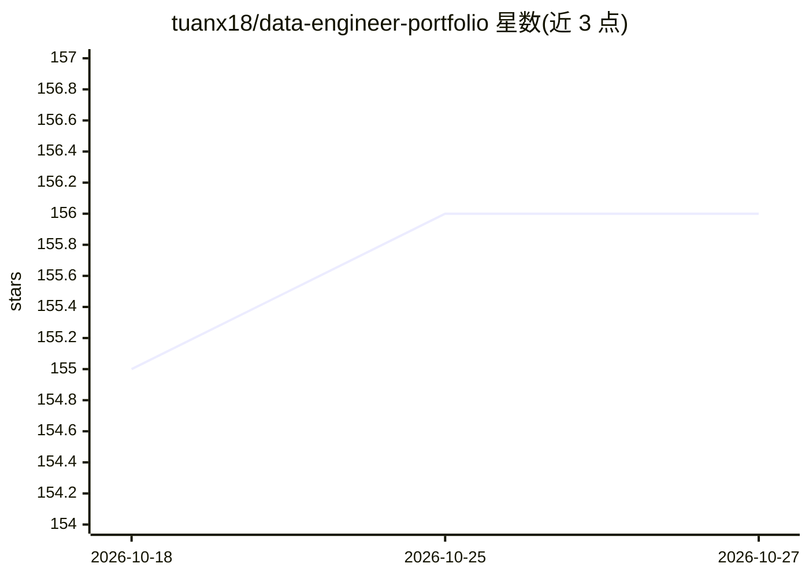

# tuanx18/data-engineer-portfolio

⭐ 156 · 推送 2026-04-14 · [GitHub](https://github.com/tuanx18/data-engineer-portfolio) · 个人维护

**个人数据工程作品集：展示技能、项目与职业进展**

一名位于越南河内的数据工程师的个人作品集仓库：以 README 形式罗列个人技术栈（GCP/AWS、Airflow、Snowflake、Spark、dbt 等）、7 项认证、职业经历叙述，以及数据工程项目说明，包括零售企业数据平台项目和开源的 Interview Trainer AI Chatbot（面试练习桌面应用，代码在另一仓库）。仓库本身为纯文档展示，不含可安装或可运行的软件，且声明为已归档的档案资料。

## 筛选速览

| 维度 | 判定 | 备注 |
|---|---|---|
| AI 角色 | `ai-knowledge` | 知识聚合/清单类 |
| 许可风险 | `none` | — |
| 部署形态 | `None` |  |
| 模型依赖 | — | README 未给出锁定关系 |
| 硬件要求 | — | 无带数字的原话,不猜 |
| 安装摩擦 | `low` | 无编译、无系统依赖或容器化 |
| 成熟度 | — | 结构信号不足 |

## 能力要点

- 列出 GCP/AWS/雪花等云数据栈与 7 项认证
- 含零售企业数据平台项目说明（Airflow + BigQuery）
- 关联开源项目 Interview Trainer AI Chatbot 仓库链接

## 适用场景

- 雇主或合作方了解该数据工程师的技能与项目经历
- 作为数据工程职业进展的存档记录

## 场景标签

 · 领域:数据工程/职业展示

## 证据(README 行号)

> L1: # Hoang Anh Tuan - A Data Engineering Portfolio
> L53: **Please note that this was an archived profile.**
> L119: **GitHub** : https://github.com/tuanx18/genAI_interview_practice_program

## 星数曲线

2026-10-18 155 → 2026-10-27 156（+1）

---
*卡片 v1 · prompt 1.4 · 生成 2026-10-22 · 置信度 low · 依据 README sha `44d6fad09891` · [字段定义](../../DATASET.md)*
