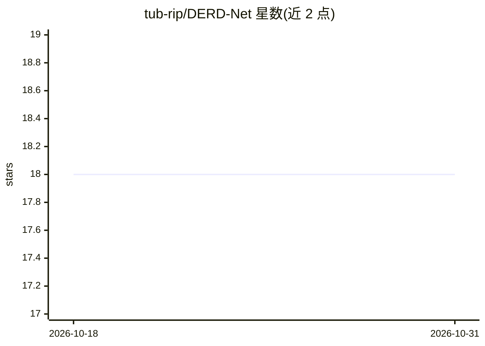

# tub-rip/DERD-Net

⭐ 18 · Jupyter Notebook · MIT · 推送 2025-11-22 · [GitHub](https://github.com/tub-rip/DERD-Net) · 组织维护

**事件相机深度估计神经网络（NeurIPS 2025）**

TU Berlin RIP 实验室发布的 DERD-Net 官方实现：从事件相机数据生成视差空间图像（DSI），网络对每个像素的局部 Sub-DSI 独立处理，输出像素级深度估计，支持单像素与多像素（3x3 网格）两种网络版本，可用于单目与立体事件视觉。代码以 Jupyter Notebook 形式提供训练、推理与可视化功能，附带预训练权重与 MVSEC 示例 DSI 数据，通过 conda 环境安装。论文入选 NeurIPS 2025 Spotlight。

## 筛选速览

| 维度 | 判定 | 备注 |
|---|---|---|
| AI 角色 | `ai-native` | 本体是模型或模型工具 |
| 许可风险 | `permissive` | MIT |
| 部署形态 | `None` |  |
| 模型依赖 | — | README 未给出锁定关系 |
| 硬件要求 | — | 无带数字的原话,不猜 |
| 安装摩擦 | `low` | 无编译、无系统依赖或容器化 |
| 成熟度 | — | 结构信号不足 |

## 能力要点

- 从事件数据构建 DSI 并对局部 Sub-DSI 逐像素预测深度
- 提供单像素与多像素（3x3 网格）两种网络版本
- 附预训练权重（.pth）与 MVSEC flying1 示例 DSI
- 代码以 Jupyter Notebook 形式覆盖训练/测试/推理/可视化

## 适用场景

- 事件相机单目或立体的深度估计研究与复现
- 无人机（MVSEC）与驾驶（DSEC）场景的事件视觉深度实验
- 在 SLAM/机器人流程中生成事件相机深度图

## 场景标签

`图像视频处理` · 领域:感知与多模态

## 证据(README 行号)

> L44: - Pixel-wise depth estimation for each Sub-DSI:
> L66: The code for our approach is provided in Jupyter Notebooks, each of which contains detailed usage instructions. The

## 星数曲线

2026-10-18 18 → 2026-10-31 18（+0）

---
*卡片 v1 · prompt 1.4 · 生成 2026-10-29 · 置信度 high · 依据 README sha `386291f8c374` · [字段定义](../../DATASET.md)*
