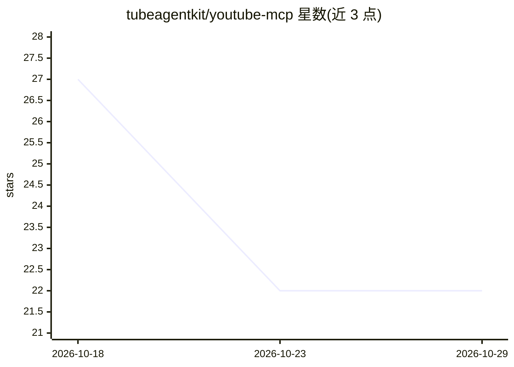

# tubeagentkit/youtube-mcp

⭐ 22 · JavaScript · MIT · 推送 2026-10-27 · [GitHub](https://github.com/tubeagentkit/youtube-mcp) · [官网](https://getyoutubetranscript.com) · 组织维护

**远程 YouTube MCP 服务器：供 AI 客户端取转录、搜索视频与频道**

托管的 Model Context Protocol 服务器，向 Claude、ChatGPT、Cursor、VS Code、Windsurf 等 15+ MCP 兼容客户端暴露 8 个 YouTube 工具：获取视频转录（可带时间戳与元数据）、列出字幕语言、搜索视频/频道、频道最新视频、频道内搜索、完整频道投稿列表、播放列表提取与余额查询。默认通过单一 HTTPS 端点远程接入，无需本地安装；认证支持 API key 与 OAuth 2.1（DCR/CIMD）。免费层注册赠 100 积分，1 积分=1 次成功请求。仓库同时构成 Agent Plugins 1.0.0 包（附带 youtube 技能文件），且 server/ 目录含基于官方 MCP TypeScript SDK 的开源 stdio 本地服务器，调用同一 REST API。

## 筛选速览

| 维度 | 判定 | 备注 |
|---|---|---|
| AI 角色 | `ai-ecosystem` | LLM/agent 周边工具 |
| 许可风险 | `permissive` | MIT |
| 部署形态 | `library` | 以包/库形式分发 |
| 模型依赖 | — | README 未给出锁定关系 |
| 硬件要求 | — | 无带数字的原话,不猜 |
| 安装摩擦 | `low` | 无编译、无系统依赖或容器化 |
| 成熟度 | — | 结构信号不足 |

## 能力要点

- 8 个工具：转录、字幕语言、视频/频道搜索、频道最新/频道内搜索/完整列表、播放列表、余额
- 远程单端点接入，无需本地安装；也提供开源 stdio 本地服务器（官方 MCP TypeScript SDK）
- API key 与 OAuth 2.1（DCR+CIMD）两种认证，token 绑定本服务器不可跨 API 重放
- 失败或限流请求不消耗积分，get_credits 免费

## 适用场景

- 让 Claude/Cursor 等 AI 客户端直接总结某个 YouTube 视频
- 在频道内搜索特定主题视频并汇总要点
- 从播放列表或频道全量拉取视频生成学习笔记或内容数据库
- 每日监控某创作者的新投稿

## 场景标签

`Agent 框架` · 领域:Agent 开发

## 证据(README 行号)

> L7:  A remote MCP server for YouTube: transcripts, video and channel search, channel browsing, in-channel search, and pl
> L17: Eight tools, one hosted endpoint, no local install, for Claude, ChatGPT, Cursor, VS Code, Windsurf, and 15+ other M
> L200: Prefer a local process? `server/` is an open-source stdio MCP server with the same 8 tools, built on the official 

## 星数曲线

2026-10-18 27 → 2026-10-29 22（-5）

---
*卡片 v1 · prompt 1.4 · 生成 2026-10-27 · 置信度 high · 依据 README sha `64d142ac8847` · [字段定义](../../DATASET.md)*
