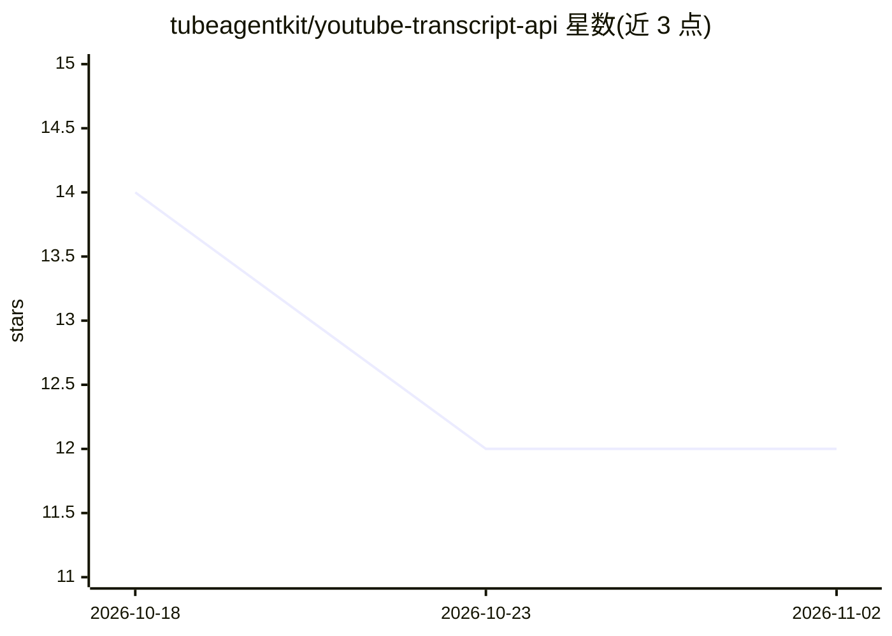

# tubeagentkit/youtube-transcript-api

⭐ 12 · MIT · 推送 2026-10-30 · [GitHub](https://github.com/tubeagentkit/youtube-transcript-api) · [官网](https://getyoutubetranscript.com/docs) · 组织维护

**面向开发者的托管 YouTube 转录/搜索 REST API 文档与示例库**

本仓库是 GetYouTubeTranscript 托管 REST API 的公开文档与示例：通过单一 API 获取 YouTube 视频转录（含逐行时间戳）、搜索、频道元数据、上传历史与播放列表，无需 Google API key 或自维护爬虫。API 本身为托管服务，仓库内不含可运行的服务端代码，提供 OpenAPI 规范与 Python、Node.js 官方 SDK，以及 curl、Python、JavaScript、Go、PHP 示例。按积分计费，免费层 100 积分、60 请求/分钟，支持批量转录（最多 100 视频，webhook 签名回调）。

## 筛选速览

| 维度 | 判定 | 备注 |
|---|---|---|
| AI 角色 | `ai-ecosystem` | LLM/agent 周边工具 |
| 许可风险 | `permissive` | MIT |
| 部署形态 | `None` |  |
| 模型依赖 | — | README 未给出锁定关系 |
| 硬件要求 | — | 无带数字的原话,不猜 |
| 安装摩擦 | `low` | 无编译、无系统依赖或容器化 |
| 成熟度 | — | 结构信号不足 |

## 能力要点

- 单一 REST API 覆盖转录、搜索、频道、播放列表等 20 余个端点
- 批量转录最多 100 视频，支持 HMAC-SHA256 签名 webhook 回调与幂等键
- 提供 OpenAPI 规范与官方 Python / Node.js SDK
- 自服务注册端点可在代码内签发 API key，免费层 100 积分无需信用卡

## 适用场景

- 获取 YouTube 视频字幕用于内容分析或 LLM 输入
- 批量拉取频道上传历史与播放列表做数据聚合
- 在应用中集成 YouTube 视频搜索与频道元数据查询

## 场景标签

`网页抓取` · 领域:效率与自动化

## 证据(README 行号)

> L7: A **YouTube Transcript API** built and hosted by GetYouTubeTranscript: get YouTube video transcripts via REST API, n
> L9: This repo is the public docs + examples home for the API: endpoint reference, the OpenAPI spec, and runnable example

## 星数曲线

2026-10-18 14 → 2026-11-02 12（-2）

---
*卡片 v1 · prompt 1.4 · 生成 2026-10-31 · 置信度 mid · 依据 README sha `a2a1098fe6e1` · [字段定义](../../DATASET.md)*
