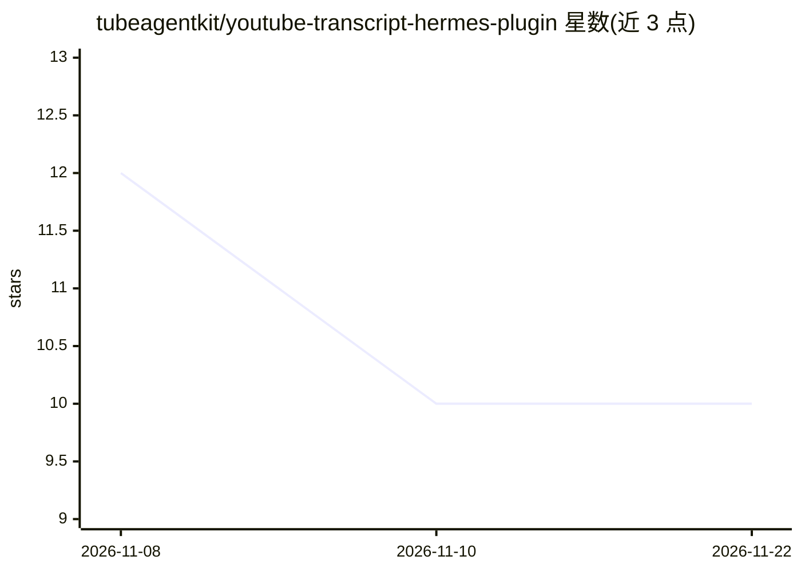

# tubeagentkit/youtube-transcript-hermes-plugin

⭐ 10 · MIT · 推送 2026-11-07 · [GitHub](https://github.com/tubeagentkit/youtube-transcript-hermes-plugin) · [官网](https://getyoutubetranscript.com/youtube-mcp-server) · 组织维护

**给 Hermes Agent 接入 YouTube 转录与检索的 MCP 插件**

将 Hermes Agent 连接到 GetYouTubeTranscript 的远程 MCP 服务器（Streamable HTTP），提供 10 个只读工具：获取带可选时间戳的 YouTube 转录、视频搜索、频道与播放列表浏览等；附带 fetch-transcript、search-youtube、summarize-video、channel-playlist-research 四个技能文件，指示 agent 何时与如何调用工具。安装后需在 getyoutubetranscript.com 注册获取 API key（注册赠 100 credits），转录抓取按 credits 计费；本包仅含配置与 Markdown 技能，无本地代码，所有调用发往远程服务器。

## 筛选速览

| 维度 | 判定 | 备注 |
|---|---|---|
| AI 角色 | `ai-ecosystem` | LLM/agent 周边工具 |
| 许可风险 | `permissive` | MIT |
| 部署形态 | `None` |  |
| 模型依赖 | — | README 未给出锁定关系 |
| 硬件要求 | — | 无带数字的原话,不猜 |
| 安装摩擦 | `low` | 无编译、无系统依赖或容器化 |
| 成熟度 | — | 结构信号不足 |

## 能力要点

- 10 个只读 MCP 工具：转录获取、视频搜索、频道/播放列表浏览
- 四个 Markdown 技能文件指示 agent 的工具使用方式
- 包体仅含 plugin.json/mcp.json 配置与技能文件，无本地代码
- API key 以 bearer token 方式发送至远程 MCP 服务器

## 适用场景

- 让 Hermes Agent 抓取 YouTube 视频转录文本（含时间戳）
- 通过自然语言搜索视频并浏览频道与播放列表
- 按技能流程对视频内容做摘要与研究

## 场景标签

`科研工具` · 领域:学习与行业

## 证据(README 行号)

> L3: Connects Hermes to the GetYouTubeTranscript remote MCP server: YouTube transcripts (with optional timestamps), video
> L7: - **MCP server** `youtube-transcript` (Streamable HTTP, `https://getyoutubetranscript.com/api/mcp`). Tools include `
> L21: - Every tool call goes to `getyoutubetranscript.com`, which receives the video URL or search text you ask about and

## 星数曲线

2026-11-08 12 → 2026-11-22 10（-2）

---
*卡片 v1 · prompt 1.4 · 生成 2026-11-19 · 置信度 high · 依据 README sha `eb27090fae78` · [字段定义](../../DATASET.md)*
