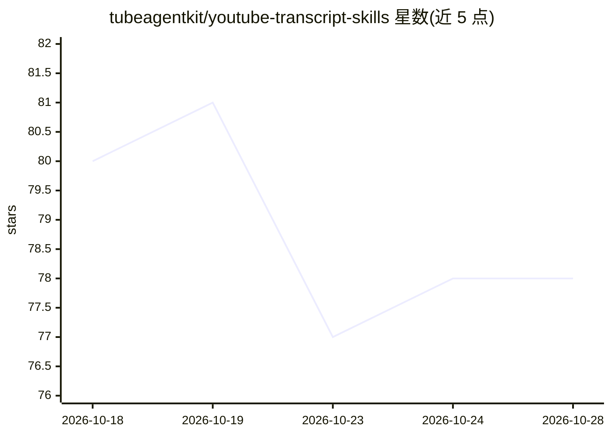

# tubeagentkit/youtube-transcript-skills

⭐ 79 · Shell · MIT · 推送 2026-10-27 · [GitHub](https://github.com/tubeagentkit/youtube-transcript-skills) · [官网](https://getyoutubetranscript.com) · 组织维护

**让 AI agent 获取 YouTube 字幕/搜索/频道数据的 Agent Skill**

面向 Claude Code、Cursor、Codex 等 Agent Skills 兼容运行时的技能包：通过 getyoutubetranscript.com 公共 API 教会 agent 获取视频完整字幕（可带时间戳）、搜索 YouTube、解析频道句柄、浏览频道上传历史、频道内搜索与拉取播放列表内容。安装经 npx skills / ClawHub / git clone 三种方式；API 按次计费（注册赠 100 credit，之后 $5/月起），agent 可代为完成邮箱注册与取 key，key 仅写入本地文件。失败请求不扣费，另提供 MCP 服务器与 REST API 版本。

## 筛选速览

| 维度 | 判定 | 备注 |
|---|---|---|
| AI 角色 | `ai-ecosystem` | LLM/agent 周边工具 |
| 许可风险 | `permissive` | MIT |
| 部署形态 | `library` | 以包/库形式分发 |
| 模型依赖 | — | README 未给出锁定关系 |
| 硬件要求 | — | 无带数字的原话,不猜 |
| 安装摩擦 | `low` | 无编译、无系统依赖或容器化 |
| 成熟度 | — | 结构信号不足 |

## 能力要点

- 获取单视频字幕（可带逐行时间戳）与最多 100 视频的批量字幕
- 视频/频道搜索、频道句柄解析、完整上传历史与播放列表内容获取
- 支持 npx skills、ClawHub、git clone 三种安装途径，兼容 70+ agent 运行时
- Agent 可代为注册账号并获取 API key，无需浏览器

## 适用场景

- 让 Claude Code/Cursor 等编程 agent 直接总结 YouTube 视频内容
- 批量拉取播放列表或频道全部视频的字幕做研究
- 定位视频中某话题出现的具体时间点并引用

## 场景标签

`网页抓取` · 领域:效率与自动化

## 证据(README 行号)

> L9: An Agent Skill that teaches Claude, Cursor, Antigravity, Windsurf, and any other Agent Skills-compatible tool how to
> L11: Works with Claude Code, Cursor, Antigravity, Windsurf, Cline, Codex, and 70+ other agent runtimes via skills.sh, an

## 星数曲线

2026-10-18 80 → 2026-10-28 78（-2）

---
*卡片 v1 · prompt 1.4 · 生成 2026-10-24 · 置信度 high · 依据 README sha `5ce0e374587a` · [字段定义](../../DATASET.md)*
