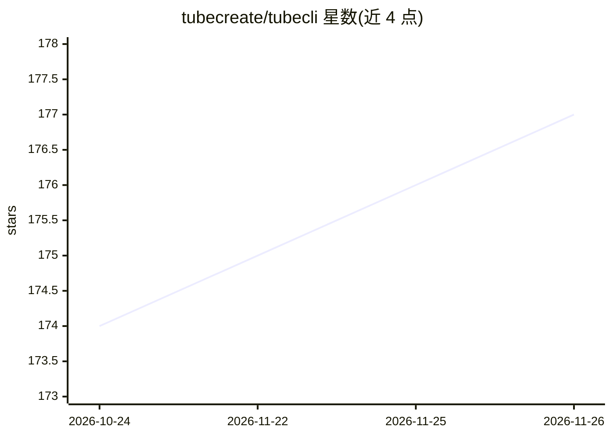

# tubecreate/tubecli

⭐ 177 · Python · MIT · 推送 2026-11-24 · [GitHub](https://github.com/tubecreate/tubecli) · [官网](https://tubecli.app) · 组织维护 · 中文 README

**自托管多 Agent 团队：自动做视频、操作浏览器、部署网站**

一个自托管的开源 AI Agent 团队运行时，通过 CLI、Web 仪表盘、Telegram 或 Flow 画布下达自然语言任务，由多 Agent 协作执行真实操作：生成并发布视频（脚本→分镜→图像→配音→渲染）、按模板部署网站到用户自己的 Cloudflare 账号、字幕提取/翻译/配音、反检测浏览器自动化。LLM 调用走本地 Ollama 或用户自己的各家 API key，破坏性任务需人工审批。需要 Python 3.10+ 与 Node.js，部署/发布功能需有效的 Cloudflare 凭据。

## 筛选速览

| 维度 | 判定 | 备注 |
|---|---|---|
| AI 角色 | `ai-ecosystem` | LLM/agent 周边工具 |
| 许可风险 | `permissive` | MIT |
| 部署形态 | `self-host` | docker 或自建部署 |
| 模型依赖 | local-ok | 支持本地模型 |
| 硬件要求 | — | 无带数字的原话,不猜 |
| 安装摩擦 | `low` | 无编译、无系统依赖或容器化 |
| 成熟度 | — | 结构信号不足 |

## 能力要点

- content_video 流水线：脚本→分镜→图像→配音→mp4，渲染可断点续跑
- 反检测浏览器配置（ShardX/BAS）加 Keychain 密码保管与 TOTP 2FA
- 破坏性任务进入 pending_approval 审批门，附 append-only JSONL 审计日志
- 零 token 快速路径：确定性意图匹配不调用模型

## 适用场景

- 让 Agent 把今天抓取的文章自动做成视频并发布到 YouTube
- 一句话把模板网站部署到自己的 Cloudflare 账号
- 批量提取/翻译字幕并克隆成多语言版本视频
- 远程在手机上审批 Agent 任务并查看部署日志

## 场景标签

`多智能体` `浏览器自动化` `视频生成` · 领域:Agent 开发

## 证据(README 行号)

> L24: **TubeCLI is a self-hosted, open-source AI agent team that executes real operational work end to end.** It is not a
> L100: **Models:** every LLM call runs on local Ollama — no API key, no per-token cost — or on Gemini, OpenAI, Claude, De

## 星数曲线

2026-10-24 174 → 2026-11-26 177（+3）

---
*卡片 v1 · prompt 1.4 · 生成 2026-11-26 · 置信度 mid · 依据 README sha `825fbceb1dfd` · [字段定义](../../DATASET.md)*
