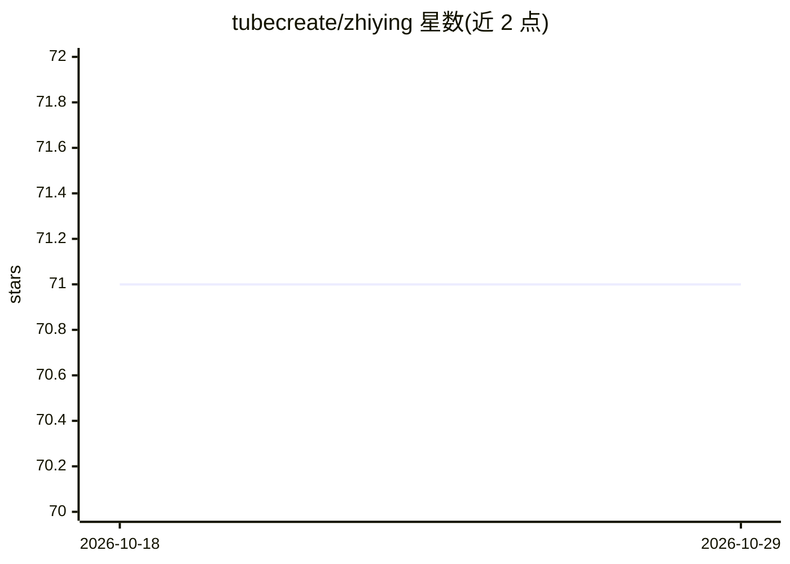

# tubecreate/zhiying

⭐ 71 · JavaScript · 推送 2026-04-02 · [GitHub](https://github.com/tubecreate/zhiying) · [官网](https://tubecreate.com) · 组织维护 · 中文 README

**开源多智能体协同系统：浏览器控制、工作流编排与 3D 可视化**

基于 CLI 与 Web 面板的 AI Agents 管理系统，含三大模块：Agents Browser 提供沙箱浏览器环境供智能体控制（Browser Profiles、指纹克隆、TOTP 2FA 登录）；Agents Workflow 为可视化拖拽的 DAG 节点工作流引擎，可在节点中调用 Ollama 本地模型或 DeepSeek/GPT 等云 API；Agents Studio World 用 Three.js 提供 3D 多智能体团队协作空间。通过 git clone 加 pip 安装，zhiying init 初始化后以 CLI 命令（agent/skill/workflow/market）与 FastAPI 面板操作。Ollama 为可选依赖。

## 筛选速览

| 维度 | 判定 | 备注 |
|---|---|---|
| AI 角色 | `ai-ecosystem` | LLM/agent 周边工具 |
| 许可风险 | `none` | — |
| 部署形态 | `library` | 以包/库形式分发 |
| 模型依赖 | local-ok | 支持本地模型 |
| 硬件要求 | — | 无带数字的原话,不猜 |
| 安装摩擦 | `low` | 无编译、无系统依赖或容器化 |
| 成熟度 | — | 结构信号不足 |

## 能力要点

- 沙箱浏览器环境：AI Agents 可获取、启动并控制 Browser Profiles
- 可视化 DAG 工作流引擎，节点可调用 Ollama 本地模型或云 API（DeepSeek/GPT）
- Three.js 构建的 3D 多智能体团队组织与角色委派空间
- CLI 无头操作通道：agent/skill/workflow/extension/market 命令集

## 适用场景

- 搭建和管理多智能体工作流并可视化编排任务
- 让 AI Agents 在沙箱浏览器中执行网页自动化操作
- 通过 CLI 或 Web 面板管理智能体、技能与插件市场

## 场景标签

`多智能体` `浏览器自动化` `工作流自动化` `Agent 框架` · 领域:Agent 开发

## 证据(README 行号)

> L22: 一个集成了本地安装、多代理管理以及可视化编排等全面能力的 **AI Agents** 智能操作系统。该系统底层基于命令行 (CLI) 形态流转，上层则拥有极具科幻感的全栈生态面板。通过我们专为大语言模型打造的三大核心矩阵：**Ag
> L33: - 支持单条 Workflow 逻辑里随意拔插、调用基于 Ollama 跑出的私有模型（或云API如 DeepSeek/GPT）。

## 星数曲线

2026-10-18 71 → 2026-10-29 71（+0）

---
*卡片 v1 · prompt 1.4 · 生成 2026-10-24 · 置信度 high · 依据 README sha `e2ed2da86024` · [字段定义](../../DATASET.md)*
