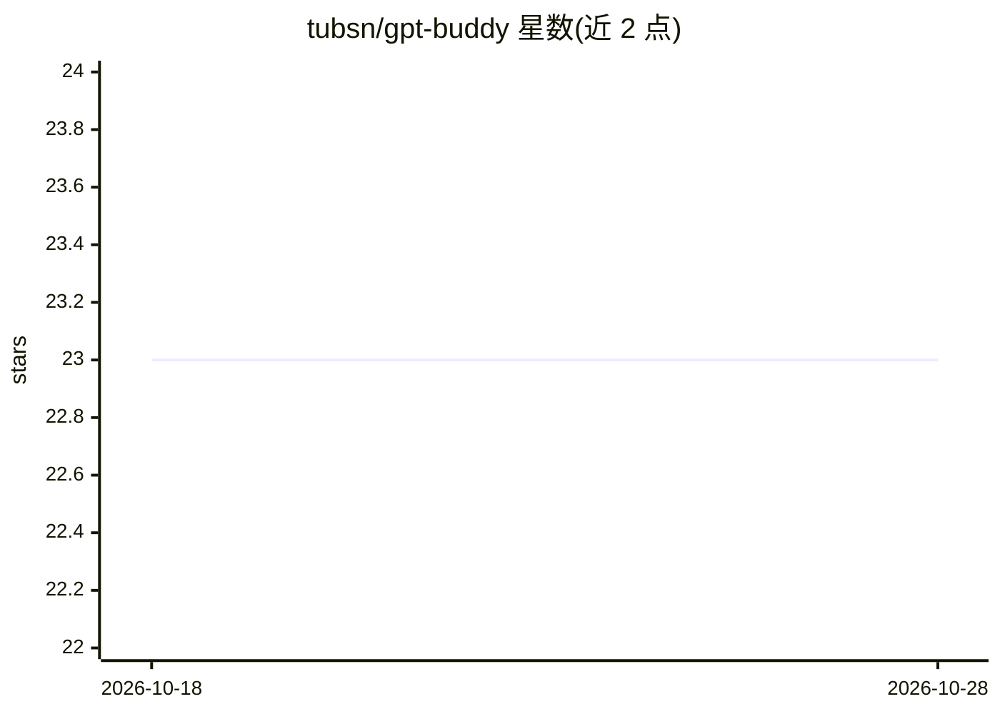

# tubsn/gpt-buddy

⭐ 23 · JavaScript · MIT · 推送 2026-10-24 · [GitHub](https://github.com/tubsn/gpt-buddy) · 个人维护

**基于 ChatGPT API 的提示词管理与交互系统**

PHP8+MySQL 的 Web 应用，围绕 OpenAI API 提供可配置的提示词数据库（含示例），支持基于预定义提示词的交互式文本生成、URL 抓取注入实时信息、OpenAI Vision 图像识别、Whisper 音频转录、文本转语音、Dall-E3 图像生成，并内置用户与权限管理、提示词使用统计。2026 年更新切换到 OpenAI Responses API，支持工具调用与 MCP 服务器接入，需联系维护者升级。部署需重命名配置文件、导入提示词数据库并运行 composer install。

## 筛选速览

| 维度 | 判定 | 备注 |
|---|---|---|
| AI 角色 | `ai-native` | 本体是模型或模型工具 |
| 许可风险 | `permissive` | MIT |
| 部署形态 | `None` |  |
| 模型依赖 | — | README 未给出锁定关系 |
| 硬件要求 | — | 无带数字的原话,不猜 |
| 安装摩擦 | `low` | 无编译、无系统依赖或容器化 |
| 成熟度 | — | 结构信号不足 |

## 能力要点

- 可配置提示词数据库并按分类（编辑/支持/销售）组织
- 集成 OpenAI 多模态能力：Vision、Whisper 转录、TTS、Dall-E3 生成
- URL 抓取注入实时信息到提示词
- 内置用户/权限管理与提示词使用统计

## 适用场景

- 企业内为团队提供分类管理的 ChatGPT 提示词门户
- 通过预定义提示词进行文本生成与图像识别
- 上传音频文件转录并生成语音

## 场景标签

`提示工程` `图像生成` `语音合成` `语音识别` · 领域:Agent 开发

## 证据(README 行号)

> L2: Prompt Management System for Interaction with the ChatGPT API
> L15: Interactive text generation based on predefined prompts with ChatGPT

## 星数曲线

2026-10-18 23 → 2026-10-28 23（+0）

---
*卡片 v1 · prompt 1.4 · 生成 2026-10-27 · 置信度 high · 依据 README sha `9634b772220c` · [字段定义](../../DATASET.md)*
