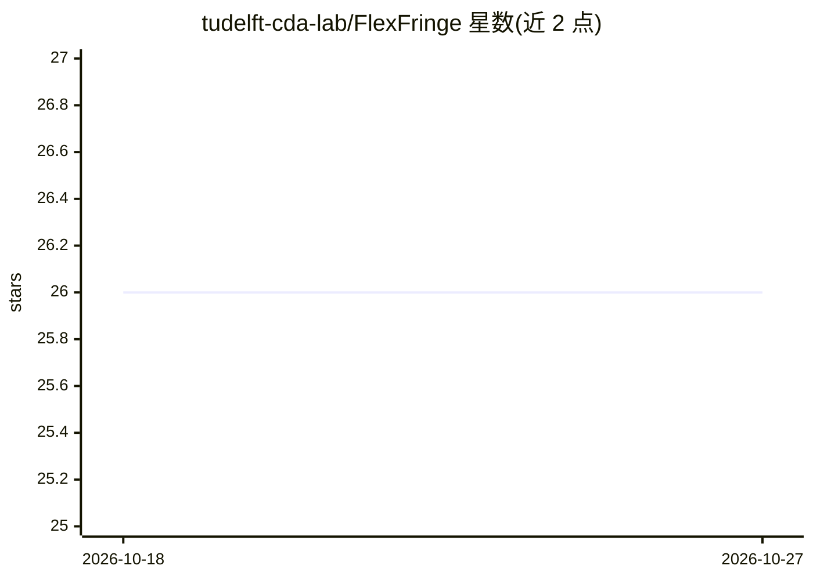

# tudelft-cda-lab/FlexFringe

⭐ 26 · C++ · GPL-3.0 · 推送 2026-10-19 · [GitHub](https://github.com/tudelft-cda-lab/FlexFringe) · 组织维护

**从轨迹学习确定性状态机的 C++ 状态合并框架**

FlexFringe（原 DFASAT）是 C++ 编写的灵活状态合并框架，用于从轨迹/符号序列中归纳确定性自动机（状态机）。核心包含状态合并框架、多种合并例程、预测模块与主动学习模块；主动学习可通过 Python 集成做深度学习推理、通过数据库连接查询成员 oracle、可选 SAT 求解归约（仅限普通 DFA 且实现未验证正确性）。输入为 Abbadingo 格式轨迹，输出 .dot 与 JSON 模型文件。以源码 CMake 编译或 Docker 镜像方式提供，面向语法归纳/机器学习研究者。README 声明单元测试与日志功能不完整。

## 筛选速览

| 维度 | 判定 | 备注 |
|---|---|---|
| AI 角色 | `ai-native` | 本体是模型或模型工具 |
| 许可风险 | `viral` | GPL-3.0 |
| 部署形态 | `desktop` | 安装包/桌面程序 |
| 模型依赖 | — | README 未给出锁定关系 |
| 硬件要求 | — | 无带数字的原话,不猜 |
| 安装摩擦 | `low` | 无编译、无系统依赖或容器化 |
| 成熟度 | — | 结构信号不足 |

## 能力要点

- 状态合并法从轨迹学习 DFA/Mealy/Moore 等状态机
- 主动学习模块：Python 深度学习集成、数据库 oracle、SAT 求解归约
- 输出 .dot/JSON 模型，支持流式/在线与批处理模式
- Docker 镜像与跨平台 CMake 编译（Linux/macOS/Windows）

## 适用场景

- 从系统日志或测试轨迹归纳软件行为的状态机模型
- 语法归纳与自动机学习研究及算法对比实验
- 将学到的模型用于语言接受测试或作为分布函数使用

## 场景标签

 · 领域:机器学习/语法归纳

## 证据(README 行号)

> L3: Flexfringe, formerly DFASAT, is a flexible state-merging framework written in C++. It consists of a core state mergi
> L109: Deep learning is done with python integration. This support is available behind the feature flag `ENABLE_PYTHON`. 

## 星数曲线

2026-10-18 26 → 2026-10-27 26（+0）

---
*卡片 v1 · prompt 1.4 · 生成 2026-10-27 · 置信度 mid · 依据 README sha `6843d9ab5c1c` · [字段定义](../../DATASET.md)*
