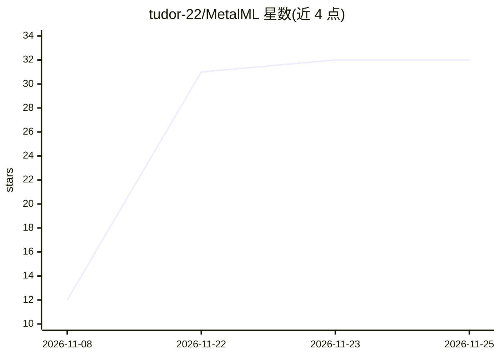

# tudor-22/MetalML

⭐ 32 · Python · Apache-2.0 · 推送 2026-11-07 · [GitHub](https://github.com/tudor-22/MetalML) · [官网](https://www.tudoriustin.com/posts/metalml) · 个人维护

**在 Mac 上用 Metal GPU 加速 scikit-learn 工作流**

面向 Apple Silicon 的开源机器学习库，提供与 scikit-learn 相同的 estimator 接口（fit/predict/transform），通过 Metal 计算内核与 Metal Performance Shaders 加速 KMeans、Ridge、PCA、核 SVM、kNN、朴素贝叶斯、随机森林等算法；不支持的 estimator 与配置自动回退到 sklearn CPU 路径，支持按代码块选择后端、严格 Metal 模式与 pickle/joblib 模型保存。GPU 路径要求 float32 稠密输入，各算法有特征数等配置限制；仅在 macOS 上执行 GPU，其他系统走 CPU 回退。

## 筛选速览

| 维度 | 判定 | 备注 |
|---|---|---|
| AI 角色 | `ai-native` | 本体是模型或模型工具 |
| 许可风险 | `permissive` | Apache-2.0 |
| 部署形态 | `library` | 以包/库形式分发 |
| 模型依赖 | — | README 未给出锁定关系 |
| 硬件要求 | — | 无带数字的原话,不猜 |
| 安装摩擦 | `medium` | 含编译或系统依赖之一 |
| 成熟度 | `idea` | |

## 能力要点

- 与 sklearn 一致的 fit/predict/transform 接口，改 import 即可使用
- Metal 内核 + Metal Performance Shaders 加速，不满足条件时自动 CPU 回退
- 支持按代码块切换后端、严格模式报错与 METALML_BACKEND 环境变量
- 覆盖预处理、聚类、回归、分类、降维、近邻等算法家族

## 适用场景

- 在 Apple Silicon 上加速已有的 sklearn 训练/推理流程
- 让 pipeline 中部分步骤走 GPU、部分保留 CPU
- 在没有 CUDA/PyTorch 依赖的环境下运行 sklearn 兼容工作流

## 场景标签

 · 领域:机器学习/科学计算

## 证据(README 行号)

> L28: MetalML is an open-source machine learning library that brings Metal GPU
> L33: Change your imports to `metalml`, keep using `fit`, `predict`, and `transform`,
> L78: MetalML covers preprocessing, clustering, regression, classification,

## 星数曲线

2026-11-08 12 → 2026-11-25 32（+20）

---
*卡片 v1 · prompt 1.4 · 生成 2026-11-22 · 置信度 high · 依据 README sha `66aa386ce6b6` · [字段定义](../../DATASET.md)*
