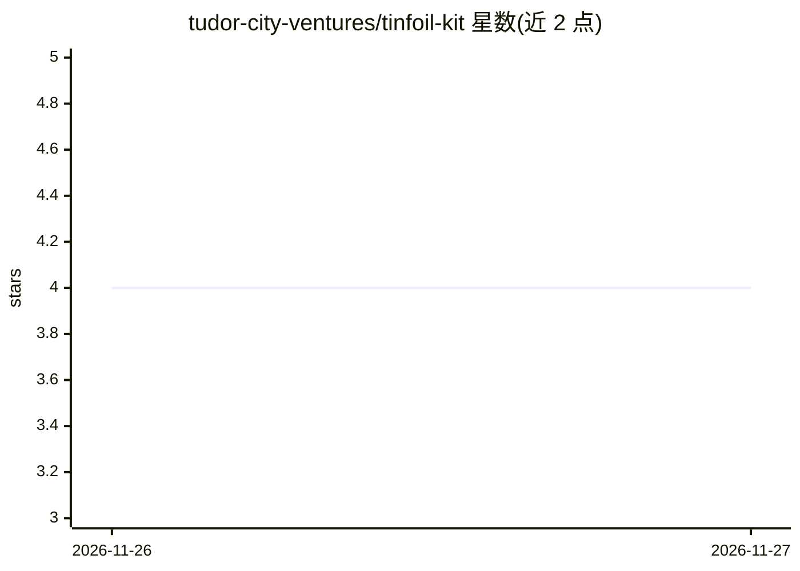

# tudor-city-ventures/tinfoil-kit

⭐ 4 · Go · MIT · 推送 2026-11-24 · [GitHub](https://github.com/tudor-city-ventures/tinfoil-kit) · [官网](https://tinfoilkit.com) · 组织维护

**离线应急知识套件：断网时提供本地 AI 问答、离线图书馆与离线地图**

一个放在电脑或外置 SSD 上的离线套件，包含三个部分：基于 llama.cpp 的本地 AI（回答并给出编号引用来源）、基于 Kiwix 的离线图书馆（Wikipedia、医学参考、维修指南、应急手册）、带地址搜索与路线规划的离线地图。联网时 SETUP 下载内容，断网时启动本地服务器（llama-server、kiwix-serve、pmtiles、Photon、GraphHopper 等），浏览器访问本地页面，无需联网、账号或安装。SETUP 按电脑内存选择 AI 模型，支持局域网分享给手机和笔记本。

## 筛选速览

| 维度 | 判定 | 备注 |
|---|---|---|
| AI 角色 | `ai-enhanced` | 去掉 AI 部分产品仍成立 |
| 许可风险 | `permissive` | MIT |
| 部署形态 | `desktop` | 安装包/桌面程序 |
| 模型依赖 | — | README 未给出锁定关系 |
| 硬件要求 | — | 无带数字的原话,不猜 |
| 安装摩擦 | `low` | 无编译、无系统依赖或容器化 |
| 成熟度 | — | 结构信号不足 |

## 能力要点

- llama.cpp 本地 AI 基于图书馆文章生成带编号引用来源的回答
- Kiwix 图书馆提供全文搜索（Wikipedia、医学、维修、应急书）
- SETUP 按电脑内存自动匹配合适的 AI 模型（./kit fit）
- 套件自带 Java 与各平台程序，Mac/Windows/Linux 共用一个外置硬盘

## 适用场景

- 断网或灾害期间查找净水、急救、停电等应急知识
- 在外置硬盘上携带整套离线百科与地图出行
- 家庭局域网内让多台设备共享离线图书馆和 AI 问答

## 场景标签

`文档问答` `推理引擎` · 领域:知识与检索

## 证据(README 行号)

> L3: An offline kit for when the internet goes down. One folder, on your computer or an external SSD, holds:
> L5: - **Local AI** (llama.cpp) that answers from the library and cites its sources.
> L45: |AI|`llama-server` (llama.cpp)|8080|Runs the AI model (Inkling 2 Mini by default). AI chat is its built-in chat pag

## 星数曲线

2026-11-26 4 → 2026-11-27 4（+0）

---
*卡片 v1 · prompt 1.4 · 生成 2026-11-26 · 置信度 mid · 依据 README sha `83b053ebcd27` · [字段定义](../../DATASET.md)*
