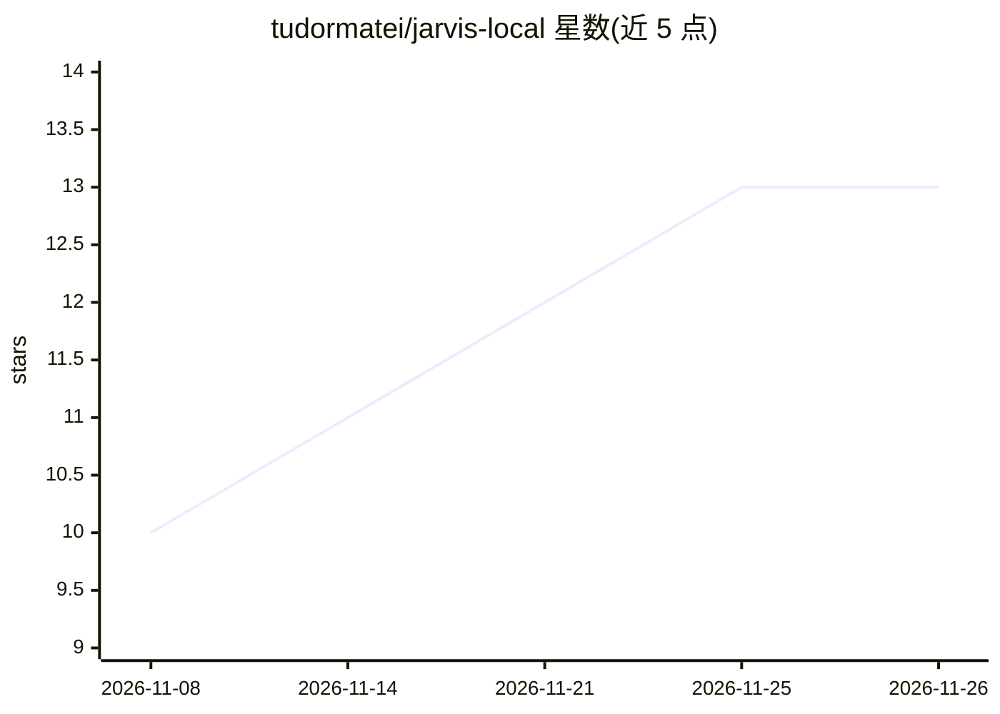

# tudormatei/jarvis-local

⭐ 13 · Python · 推送 2026-03-27 · [GitHub](https://github.com/tudormatei/jarvis-local) · 个人维护

**本地全离线的语音/文本 AI 语音助手，注重隐私**

模块化语音/文本助手，全部推理在本地运行，不依赖云端：LLM 对话由 Ollama 提供流式响应与对话记忆，STT 使用 NVIDIA Parakeet 实时转录，TTS 使用 Pocket TTS 低延迟合成。系统流式衔接各阶段（TTS 在 LLM 完成前启动），语音结束后约 2 秒出声。支持文本/语音输入输出、CLI/GUI 界面、push-to-talk。以 Python 源码运行，需 conda 环境、CUDA 12.4+，主要为 Windows 设计，可用 PyInstaller 打包成可执行文件。仅限个人非商业使用。

## 筛选速览

| 维度 | 判定 | 备注 |
|---|---|---|
| AI 角色 | `ai-native` | 本体是模型或模型工具 |
| 许可风险 | `none` | — |
| 部署形态 | `desktop` | 安装包/桌面程序 |
| 模型依赖 | local-ok | 支持本地模型 |
| 硬件要求 | — | 无带数字的原话,不猜 |
| 安装摩擦 | `medium` | 含编译或系统依赖之一 |
| 成熟度 | — | 结构信号不足 |

## 能力要点

- 本地 LLM 流式响应与对话记忆（Ollama）
- NVIDIA Parakeet STT 与 Pocket TTS 管线，端到端首音延迟约 1.9-2.0 秒
- 文本/语音 × CLI/GUI 多种运行模式，支持 push-to-talk
- 可打包为独立 Windows 可执行文件

## 适用场景

- 在本地机器上搭建隐私优先的语音对话助手
- 离线环境下通过语音与 LLM 交互
- 以 CLI 文本模式进行键盘对话

## 场景标签

`语音 Agent` · 领域:对话与助手

## 证据(README 行号)

> L3: **JARVIS Local** is a modular, privacy-focused voice/text assistant inspired by the iconic Iron Man AI that runs ent
> L9: - **Local LLM:** Fast, streaming responses with conversation memory using Ollama.

## 星数曲线

2026-11-08 10 → 2026-11-26 13（+3）

---
*卡片 v1 · prompt 1.4 · 生成 2026-11-18 · 置信度 high · 依据 README sha `aec91255e7ea` · [字段定义](../../DATASET.md)*
