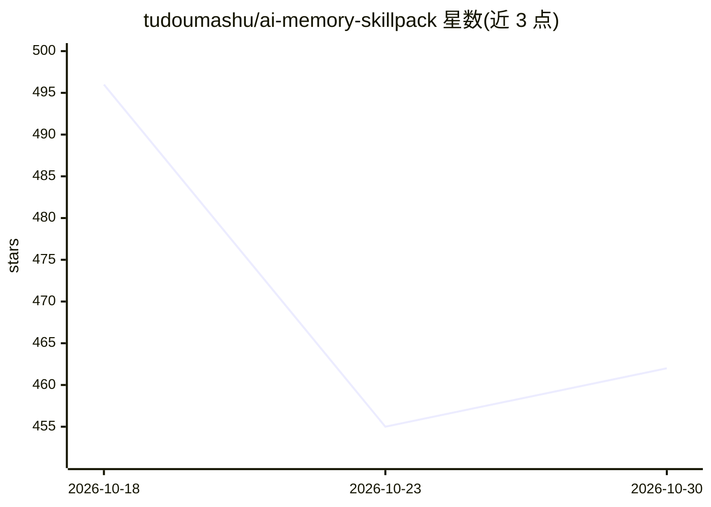

# tudoumashu/ai-memory-skillpack

⭐ 462 · Python · MIT · 推送 2026-09-08 · [GitHub](https://github.com/tudoumashu/ai-memory-skillpack) · 个人维护 · 中文 README

**给 Codex CLI/Claude Code 的有界项目记忆技能包**

面向 Codex CLI 的项目记忆系统：通过技能（ai-project-memory、可选 llm-wiki、project-mastery-coach）、constitution（SYSTEM.md）、代理可执行的安装器（INSTALL.md）与失败即关闭的验证器（VERIFY.md）实现分层记忆。机制包括 HOT/WARM/COLD 读取分层、单页快照式 handoff（replace-guard + flock）、SHA256SUMS 完整性校验、基于收据哈希的可逆升级、禁止密钥入库。同一技能源通过符号链接支持 Claude Code。要求 Linux/WSL、bash≥4.4、git、rg、sha256sum；macOS 需 GNU 工具否则安装停止。无 Obsidian wiki 时仅安装核心技能。

## 筛选速览

| 维度 | 判定 | 备注 |
|---|---|---|
| AI 角色 | `ai-ecosystem` | LLM/agent 周边工具 |
| 许可风险 | `permissive` | MIT |
| 部署形态 | `None` |  |
| 模型依赖 | — | README 未给出锁定关系 |
| 硬件要求 | — | 无带数字的原话,不猜 |
| 安装摩擦 | `low` | 无编译、无系统依赖或容器化 |
| 成熟度 | — | 结构信号不足 |

## 能力要点

- HOT/WARM/COLD 三层读取策略，handoff 为单页快照而非追加日志
- 代理可执行的 INSTALL.md 安装器与 VERIFY.md 断言式验收（fail-closed）
- 收据哈希机制保证升级不覆盖用户编辑，旧包归档不销毁
- 一份技能源同时服务 Codex 与 Claude Code（符号链接，无分叉副本）

## 适用场景

- 让 Codex 跨会话记住仓库结构、陷阱与交接状态
- 控制 agent 记忆的上下文开销，避免无上限的笔记污染
- 在 Claude Code 上复用同一套项目记忆技能

## 场景标签

`Agent 记忆` · 领域:Agent 开发

## 证据(README 行号)

> L5: A bounded, fail-closed project-memory system for Codex CLI. Optional Claude Code support on the same skill source.
> L16: Codex already writes code, reviews diffs, and triages failures. What it still lacks, out of the box, is a **durable
> L57: - **One skill source, two harnesses.** Codex holds the files; a second harness gets symlinks. No forked copies.

## 星数曲线

2026-10-18 496 → 2026-10-30 462（-34）

---
*卡片 v1 · prompt 1.4 · 生成 2026-10-21 · 置信度 high · 依据 README sha `f0bec5eae4ed` · [字段定义](../../DATASET.md)*
