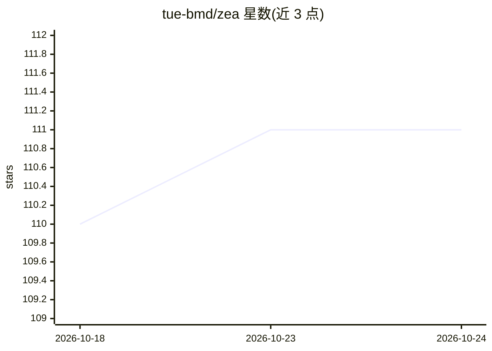

# tue-bmd/zea

⭐ 111 · Python · Apache-2.0 · 推送 2026-10-23 · [GitHub](https://github.com/tue-bmd/zea) · [官网](https://zea.readthedocs.io) · 组织维护

**认知超声成像工具箱：信号处理、图像重建与深度学习**

基于 Keras 3 的 Python 超声成像库，提供可微分信号处理与图像重建 Pipeline、超声数据加载工具（支持 Hugging Face 数据集流式读取）、Hugging Face 托管的预训练模型，以及用于认知超声的动作选择 Agent（决定下一步采集哪些扫描线）。后端可运行于 JAX、PyTorch 或 TensorFlow。通过 pip 安装，需自行安装其中一种 Keras 后端；附 Colab 示例笔记本与 JOSS 论文。

## 筛选速览

| 维度 | 判定 | 备注 |
|---|---|---|
| AI 角色 | `ai-native` | 本体是模型或模型工具 |
| 许可风险 | `permissive` | Apache-2.0 |
| 部署形态 | `library` | 以包/库形式分发 |
| 模型依赖 | — | README 未给出锁定关系 |
| 硬件要求 | — | 无带数字的原话,不猜 |
| 安装摩擦 | `low` | 无编译、无系统依赖或容器化 |
| 成熟度 | — | 结构信号不足 |

## 能力要点

- 可微分的信号处理与图像重建 Pipeline
- Hugging Face 数据集流式加载，仅读取所需帧
- Hugging Face 托管的预训练超声模型
- 认知超声 Agent：动作决定下一步采集设计

## 适用场景

- 我在做超声深度学习研究，需要信号处理与重建管线
- 我想流式读取超声数据集训练模型
- 我需要预训练超声模型直接做图像与信号处理

## 场景标签

 · 领域:医学影像/超声

## 证据(README 行号)

> L23: `zea` is a Python library for ultrasound signal processing, image reconstruction, and deep learning. It is built on
> L50:  🔧&nbsp; Pipeline
> L56:  🧠&nbsp; Models

## 星数曲线

2026-10-18 110 → 2026-10-24 111（+1）

---
*卡片 v1 · prompt 1.4 · 生成 2026-10-23 · 置信度 high · 依据 README sha `c26eec86c89e` · [字段定义](../../DATASET.md)*
