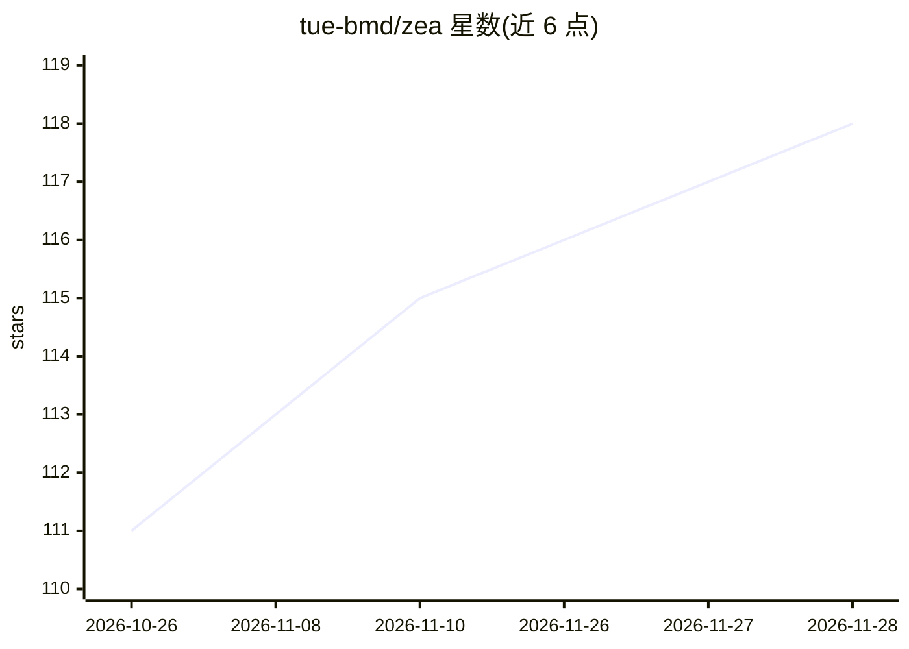

# tue-bmd/zea

⭐ 118 · Python · Apache-2.0 · 推送 2026-11-27 · [GitHub](https://github.com/tue-bmd/zea) · [官网](https://zea.readthedocs.io) · 组织维护

**面向超声研究者的信号处理、图像重建与深度学习工具库**

Python 库，提供超声信号处理、图像重建和深度学习工具链，构建于 Keras 3 之上，可在 JAX、PyTorch 或 TensorFlow 后端运行。核心模块包括可微分流水线（Pipeline）、面向深度学习工作流的超声数据加载（从 Hugging Face 流式读取数据集）、托管于 Hugging Face 的预训练模型，以及认知超声的动作选择 Agent（决定下一次采集的扫描线等）。pip 安装，文档提供入门指南与可在 Colab 打开的示例笔记本，并以 JOSS 论文形式提供引用说明。

## 筛选速览

| 维度 | 判定 | 备注 |
|---|---|---|
| AI 角色 | `ai-native` | 本体是模型或模型工具 |
| 许可风险 | `permissive` | Apache-2.0 |
| 部署形态 | `library` | 以包/库形式分发 |
| 模型依赖 | — | README 未给出锁定关系 |
| 硬件要求 | — | 无带数字的原话,不猜 |
| 安装摩擦 | `low` | 无编译、无系统依赖或容器化 |
| 成熟度 | — | 结构信号不足 |

## 能力要点

- 基于 Keras 3，可在 JAX/PyTorch/TensorFlow 后端运行
- 可微分超声信号处理与图像重建流水线
- 预训练超声模型与数据集托管于 Hugging Face 并流式加载
- Agent 模块支持认知超声的采集动作选择

## 适用场景

- 对超声原始数据进行波束成形并生成 B 模式图像
- 为超声深度学习工作流加载数据集与预训练模型
- 设计认知超声中自适应采集策略的研究实验

## 场景标签

`科研工具` · 领域:学习与行业

## 证据(README 行号)

> L23: `zea` is a Python library for ultrasound signal processing, image reconstruction, and deep learning. It is built on
> L37: `zea` offers many models and tooling for advanced ultrasound processing. But in the most basic sense it offers a fa
> L59:  🎯&nbsp; Agent

## 星数曲线

2026-10-26 111 → 2026-11-28 118（+7）

---
*卡片 v1 · prompt 1.4 · 生成 2026-11-28 · 置信度 high · 依据 README sha `66d0c1aa9dbe` · [字段定义](../../DATASET.md)*
