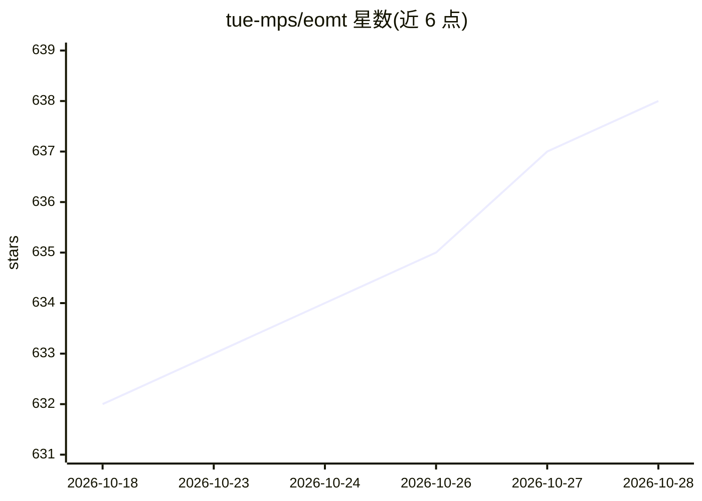

# tue-mps/eomt

⭐ 638 · Jupyter Notebook · MIT · 推送 2026-10-12 · [GitHub](https://github.com/tue-mps/eomt) · [官网](https://www.tue-mps.org/eomt/) · 组织维护

**CVPR 2025 图像分割模型：用纯 ViT 做全景/实例/语义分割**

Eindhoven 理工、都灵理工与 RWTH 联合发布的 Encoder-only Mask Transformer（EoMT）官方代码与模型：复用朴素 Vision Transformer，将图像 patch 与分割 query 作为 token 联合编码，不使用适配器与解码器，完成全景、实例与语义分割。提供 DINOv2 与 DINOv3 两种骨干的预训练权重（Model Zoo），基于 PyTorch Lightning 训练与评测，支持多 GPU；DINOv2 版本亦接入 Hugging Face Transformers。训练配置在 4×H100 上约需 6 小时，单卡约 26GB 显存。

## 筛选速览

| 维度 | 判定 | 备注 |
|---|---|---|
| AI 角色 | `ai-native` | 本体是模型或模型工具 |
| 许可风险 | `permissive` | MIT |
| 部署形态 | `library` | 以包/库形式分发 |
| 模型依赖 | — | README 未给出锁定关系 |
| 硬件要求 | `gpu-24g` | |
| 安装摩擦 | `low` | 无编译、无系统依赖或容器化 |
| 成熟度 | — | 结构信号不足 |

## 能力要点

- 纯 ViT 编码器完成全景/实例/语义分割，无适配器与解码器
- 提供 DINOv2 与 DINOv3 骨干的预训练权重 Model Zoo
- DINOv2 版本上架 Hugging Face Transformers
- 支持 COCO/ADE20K/Cityscapes 训练与多 GPU 评测

## 适用场景

- 在 COCO/ADE20K/Cityscapes 上训练或微调分割模型
- 下载预训练权重做图像分割推理与可视化
- 复现或对比 CVPR 2025 论文实验结果

## 场景标签

`目标检测` · 领域:感知与多模态

## 证据(README 行号)

> L16: We present the **Encoder-only Mask Transformer (EoMT)**, a minimalist image segmentation model that repurposes a pl
> L42: - **Panoptic Segmentation**: Up to 58.9 PQ on COCO with EoMT-L at 1280×1280

## 星数曲线

2026-10-18 632 → 2026-10-28 638（+6）

---
*卡片 v1 · prompt 1.4 · 生成 2026-10-21 · 置信度 high · 依据 README sha `87b7aaf583da` · [字段定义](../../DATASET.md)*
