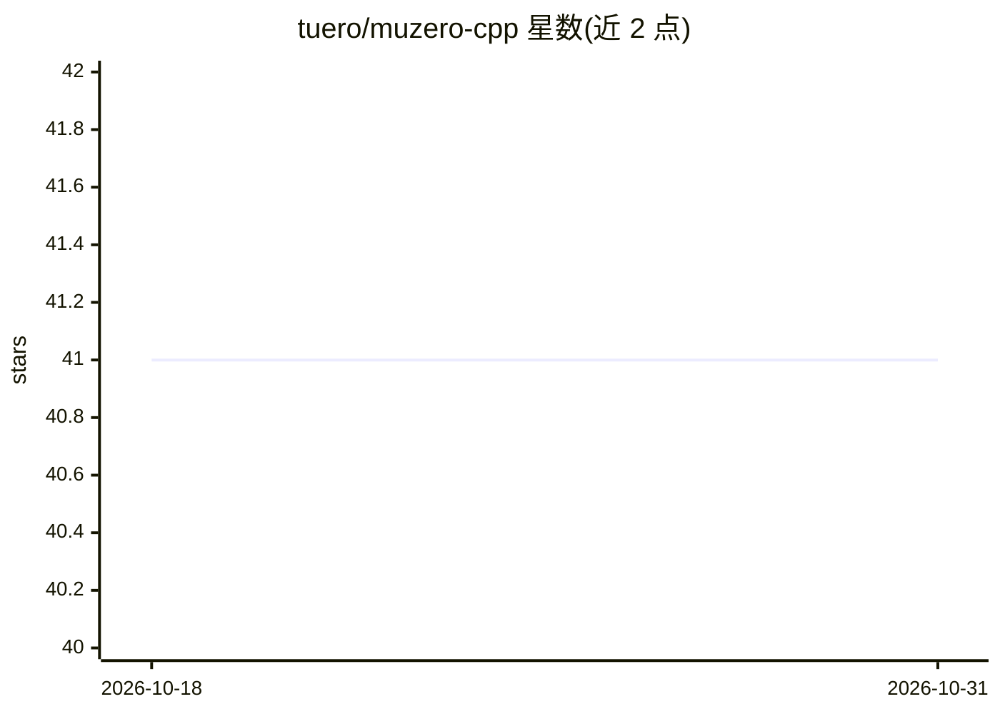

# tuero/muzero-cpp

⭐ 41 · C++ · Apache-2.0 · 推送 2026-05-18 · [GitHub](https://github.com/tuero/muzero-cpp) · 个人维护

**C++/libtorch 实现的 MuZero 强化学习算法库**

用 C++ 与 libtorch 实现的完整 MuZero 算法，定位为库供扩展自定义游戏环境：提供多线程异步 actor 推理、多 CPU/GPU 设备支持、Reanalyze、优先级回放缓冲、TensorBoard 日志、json 模型配置与断点续训，支持 ALE 环境。通过 vcpkg 个人 registry 安装依赖，libtorch 需单独经 pip 获取并设置 LIBTORCH_ROOT，用 CMake preset 从源码编译，要求 C++23 编译器。作者声明无法保证实现无 bug（缺算力对比已报告结果）。附带 Connect4 与 Pong 预训练模型，可人机对弈测试。

## 筛选速览

| 维度 | 判定 | 备注 |
|---|---|---|
| AI 角色 | `ai-native` | 本体是模型或模型工具 |
| 许可风险 | `permissive` | Apache-2.0 |
| 部署形态 | `library` | 以包/库形式分发 |
| 模型依赖 | — | README 未给出锁定关系 |
| 硬件要求 | — | 无带数字的原话,不猜 |
| 安装摩擦 | `high` | 编译与系统依赖俱全 |
| 成熟度 | `idea` | |

## 能力要点

- 多线程异步 actor 推理与多设备（CPU/GPU）学习推理
- Reanalyze、优先级回放缓冲与周期性检查点续训
- 通过 vcpkg registry 作为库集成，json 配置模型
- 附带 Connect4 与 Pong（ALE）预训练模型，支持人机对弈

## 适用场景

- 在纯 C++ 运行时中训练 MuZero 智能体
- 扩展自定义游戏环境做强化学习实验
- 用预训练模型测试或人机对弈

## 场景标签

`强化学习` · 领域:训练与推理

## 证据(README 行号)

> L3: This project is a complete C++ implementation of the MuZero algorithm, inspired by the work done by MuZero General.
> L4: The motivation behind this project is for the added speed C++ provides, efficient batched inference on the GPU, as w

## 星数曲线

2026-10-18 41 → 2026-10-31 41（+0）

---
*卡片 v1 · prompt 1.4 · 生成 2026-10-25 · 置信度 mid · 依据 README sha `e18c4710e8fa` · [字段定义](../../DATASET.md)*
