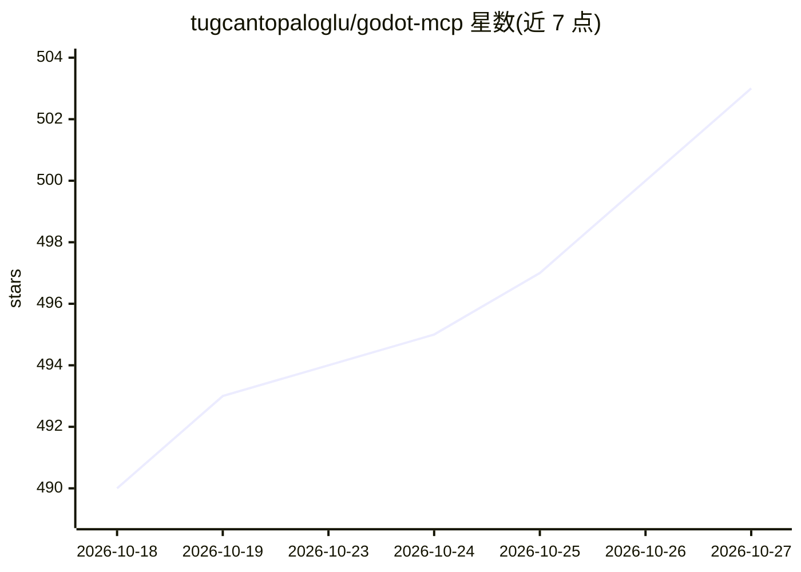

# tugcantopaloglu/godot-mcp

⭐ 503 · TypeScript · MIT · 推送 2026-10-09 · [GitHub](https://github.com/tugcantopaloglu/godot-mcp) · 个人维护

**让 AI 助手全面控制 Godot 引擎的 MCP 服务器（157 个工具）**

基于 Model Context Protocol 的服务器，向 AI 助手开放 Godot 4.x 引擎的完整控制能力：157 个工具覆盖运行时代码执行（game_eval）、节点属性读写与内省、信号管理、动画/物理/音频/3D 渲染操作、无头场景文件编辑、GDScript 语法诊断、项目创建与导出、网络与输入模拟等。支持 C#/.NET 项目脚手架与脚本生成。要求 Godot 4.4 及以上，在 Godot 4.7 测试。由原 20 工具的 godot-mcp fork 扩展而来。

## 筛选速览

| 维度 | 判定 | 备注 |
|---|---|---|
| AI 角色 | `ai-ecosystem` | LLM/agent 周边工具 |
| 许可风险 | `permissive` | MIT |
| 部署形态 | `library` | 以包/库形式分发 |
| 模型依赖 | — | README 未给出锁定关系 |
| 硬件要求 | — | 无带数字的原话,不猜 |
| 安装摩擦 | `medium` | 含编译或系统依赖之一 |
| 成熟度 | — | 结构信号不足 |

## 能力要点

- 157 个工具：运行时代码执行、节点内省、场景文件无头编辑
- GDScript 语法/类型诊断（validate_script，批量校验 git 变更文件）
- C#/.NET 项目脚手架与 C# 脚本生成（csproj SDK 版本匹配 Godot）
- 物理/动画/音频/3D 渲染/网络/输入模拟等引擎子系统运行时控制

## 适用场景

- 让 AI 助手驱动 Godot 进行游戏开发与调试
- Agent 编辑代码后无头校验 GDScript 语法与类型错误
- 通过 AI 运行时操控节点、信号与场景结构进行自动化测试

## 场景标签

`代码生成` · 领域:编码与开发

## 证据(README 行号)

> L7: A comprehensive Model Context Protocol (MCP) server that gives AI assistants **full control** over the Godot game en
> L3: # Godot MCP - Full Control

## 星数曲线

2026-10-18 490 → 2026-10-27 503（+13）

---
*卡片 v1 · prompt 1.4 · 生成 2026-10-21 · 置信度 mid · 依据 README sha `f0ee88af1e49` · [字段定义](../../DATASET.md)*
