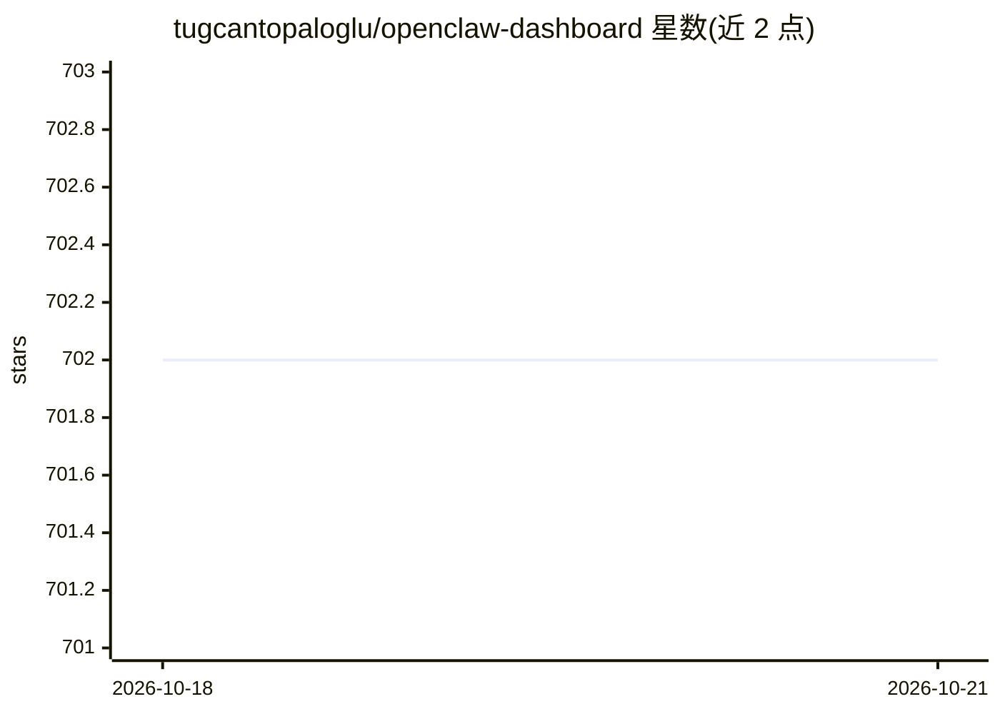

# tugcantopaloglu/openclaw-dashboard

⭐ 701 · HTML · 推送 2026-10-09 · [GitHub](https://github.com/tugcantopaloglu/openclaw-dashboard) · [官网](https://github.com/tugcantopaloglu/openclaw-dashboard/releases/tag/v2.0.0) · 个人维护

**OpenClaw AI agent 的实时监控面板：会话/成本/内存/系统健康一站式查看**

纯 Node.js 实现的 Web 监控面板，用于监控 OpenClaw agent：会话管理、Claude 与 Gemini API 用量及速率限制追踪、按模型/会话/时段的成本分析、实时消息流、agent 内存文件浏览、工作区文件编辑、CPU/RAM/磁盘/温度系统健康监控、cron 任务管理、Docker 容器管理、Tailscale 状态展示等。安全方面提供用户名密码认证（PBKDF2 哈希）、可选 TOTP MFA、速率限制登录、HSTS/CSP 等安全头与审计日志。无数据库、无 npm 依赖，需 Node.js v18+ 与已安装的 OpenClaw，支持 systemd 服务与 Docker 部署。

## 筛选速览

| 维度 | 判定 | 备注 |
|---|---|---|
| AI 角色 | `ai-ecosystem` | LLM/agent 周边工具 |
| 许可风险 | `permissive` | — |
| 部署形态 | `self-host` | docker 或自建部署 |
| 模型依赖 | — | README 未给出锁定关系 |
| 硬件要求 | — | 无带数字的原话,不猜 |
| 安装摩擦 | `low` | 无编译、无系统依赖或容器化 |
| 成熟度 | — | 结构信号不足 |

## 能力要点

- 会话、API 用量、速率限制与成本的实时监控（5 秒自动刷新）
- 用户名密码认证 + 可选 TOTP MFA，含 HSTS/CSP/审计日志等安全加固
- agent 内存文件浏览、工作区文件编辑与配置编辑器
- 纯 Node.js 无数据库与 npm 依赖，支持 systemd 与 Docker 部署

## 适用场景

- 在面板中统一查看 OpenClaw agent 的会话与用量成本
- 浏览和编辑 agent 的 MEMORY.md 等内存文件与工作区配置
- 在树莓派/服务器上远程监控 agent 所在系统的健康与安全状态

## 场景标签

 · 领域:AI agent 运维/监控

## 证据(README 行号)

> L9: A beautiful, secure, real-time monitoring dashboard for OpenClaw agents. Track sessions, monitor API usage, view cos
> L25: - **Session Management** - View all agent sessions with real-time activity status
> L31: - **System Health** - CPU, RAM, disk, temperature monitoring with sparklines

## 星数曲线

2026-10-18 702 → 2026-10-21 702（+0）

---
*卡片 v1 · prompt 1.4 · 生成 2026-10-22 · 置信度 high · 依据 README sha `0250b3e39ac9` · [字段定义](../../DATASET.md)*
