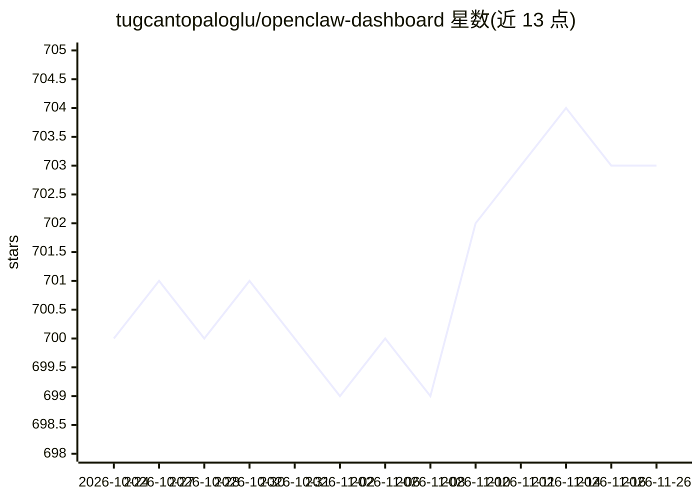

# tugcantopaloglu/openclaw-dashboard

⭐ 703 · HTML · MIT · 推送 2026-11-05 · [GitHub](https://github.com/tugcantopaloglu/openclaw-dashboard) · [官网](https://github.com/tugcantopaloglu/openclaw-dashboard/releases/latest) · 个人维护

**为 OpenClaw AI agent 提供安全实时监控面板**

基于纯 Node.js（无数据库、无 npm 依赖）的 Web 面板，用于监控运行中的 OpenClaw agent：会话管理、API 用量与费用统计、实时消息流、内存文件浏览、系统健康与日志查看、cron 与容器管理。安全机制包括用户名密码认证（PBKDF2）、可选 TOTP 双因素、恢复令牌、速率限制与审计日志。支持源码运行、systemd 服务或 Docker 部署，兼容 macOS 统计并标注适用于 Raspberry Pi。

## 筛选速览

| 维度 | 判定 | 备注 |
|---|---|---|
| AI 角色 | `ai-ecosystem` | LLM/agent 周边工具 |
| 许可风险 | `permissive` | MIT |
| 部署形态 | `self-host` | docker 或自建部署 |
| 模型依赖 | — | README 未给出锁定关系 |
| 硬件要求 | — | 无带数字的原话,不猜 |
| 安装摩擦 | `low` | 无编译、无系统依赖或容器化 |
| 成熟度 | — | 结构信号不足 |

## 能力要点

- 纯 Node.js 实现，无需数据库或 npm 包
- PBKDF2 认证 + 可选 TOTP MFA + 恢复令牌机制
- Claude/Gemini API 用量与费用追踪、每模型细分
- 系统健康、服务控制、Docker 管理与审计日志

## 适用场景

- 集中监控多会话 agent 的用量与费用
- 远程查看 agent 内存文件与工作区配置
- 在树莓派或小型服务器上以服务方式常驻运行

## 场景标签

 · 领域:开发者工具/监控运维

## 证据(README 行号)

> L9: A beautiful, secure, real-time monitoring dashboard for OpenClaw agents. Track sessions, monitor API usage, view cos
> L25: - **Session Management** - View all agent sessions with real-time activity status

## 星数曲线

2026-10-24 700 → 2026-11-26 703（+3）

---
*卡片 v1 · prompt 1.4 · 生成 2026-11-24 · 置信度 high · 依据 README sha `3d2df887d057` · [字段定义](../../DATASET.md)*
