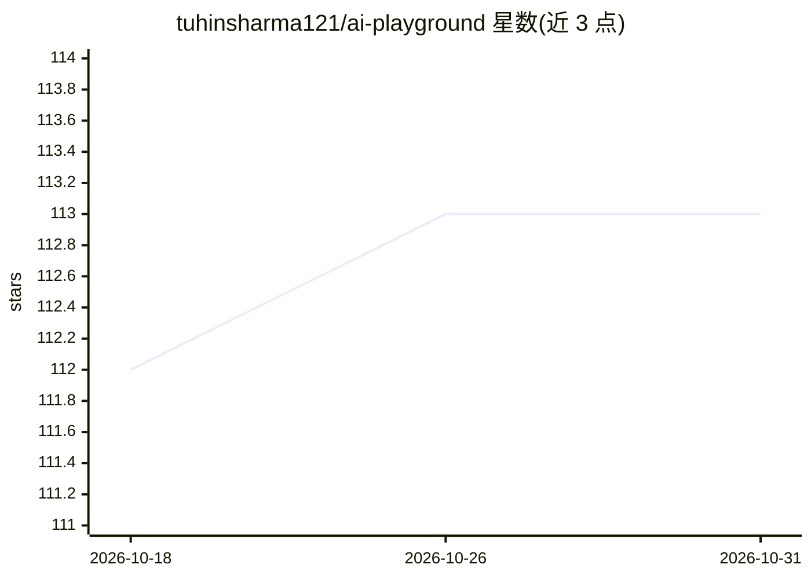

# tuhinsharma121/ai-playground

⭐ 113 · Jupyter Notebook · Apache-2.0 · 推送 2026-10-09 · [GitHub](https://github.com/tuhinsharma121/ai-playground) · 个人维护

**AI 技术文章与会议演讲的可复现代码笔记本合集**

作者在 Medium、O'Reilly 发表文章并在 Strata、PyCon、PyData 等会议演讲的配套代码库，以 Jupyter 笔记本形式提供。内容覆盖 RAG 变体（LlamaIndex RAG、RAPTOR、Adaptive-RAG、GraphRAG、Microsoft GraphRAG、HippoRAG、Fast GraphRAG）、嵌入模型微调、联邦学习网络威胁检测、LlamaGuard 内容审核等主题。每个笔记本对应一篇已发表文章或演讲，供读者复现和跟随学习，面向 AI 开发者与学习者。

## 筛选速览

| 维度 | 判定 | 备注 |
|---|---|---|
| AI 角色 | `ai-knowledge` | 知识聚合/清单类 |
| 许可风险 | `permissive` | Apache-2.0 |
| 部署形态 | `None` |  |
| 模型依赖 | — | README 未给出锁定关系 |
| 硬件要求 | — | 无带数字的原话,不猜 |
| 安装摩擦 | `low` | 无编译、无系统依赖或容器化 |
| 成熟度 | — | 结构信号不足 |

## 能力要点

- 11+ 个与已发表文章一一对应的可复现笔记本
- 覆盖多种 GraphRAG 变体（RAPTOR、HippoRAG、Fast GraphRAG 等）
- 包含联邦学习威胁检测与 LlamaGuard 审核等应用案例

## 适用场景

- 跟随文章复现各类 RAG 流水线的实现
- 对比不同 GraphRAG 方案的代码做法
- 学习联邦学习用于网络威胁检测的示例

## 场景标签

`RAG` `网络安全` `微调` `教程课程` · 领域:知识与检索

## 证据(README 行号)

> L6: You shall find the codebase for all the articles and the talks here.
> L8: |Sl No|Article|Notbeook|

## 星数曲线

2026-10-18 112 → 2026-10-31 113（+1）

---
*卡片 v1 · prompt 1.4 · 生成 2026-10-23 · 置信度 high · 依据 README sha `76ece03df21b` · [字段定义](../../DATASET.md)*
