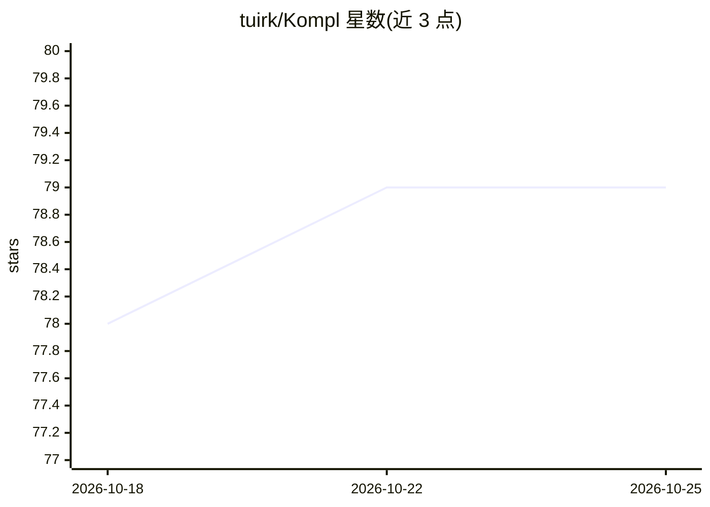

# tuirk/Kompl

⭐ 79 · TypeScript · Apache-2.0 · 推送 2026-10-25 · [GitHub](https://github.com/tuirk/Kompl) · [官网](https://github.com/tuirk/Kompl) · 个人维护

**自我更新式 LLM 个人维基：存入资料即自动整理成知识库**

面向个人知识管理的 Docker 化 LLM-wiki：保存链接、PDF、推文串、YouTube 视频等来源后，本地 spaCy NLP 做实体与关键短语提取，单次 LLM 调用抽取实体/概念/主张/矛盾，实体消解采用别名查表→模糊匹配→本地嵌入→LLM 级联，自动撰写并更新互链 wiki 页面，观点分歧写入带溯源的对比页。编译后端需 Gemini 或 DeepSeek 之一，Firecrawl 必需。附带引用式聊天与 4 个只读工具的 MCP 服务器（可接 Cursor/Claude Code 等 agent）。单租户设计，无多用户认证。

## 筛选速览

| 维度 | 判定 | 备注 |
|---|---|---|
| AI 角色 | `ai-native` | 本体是模型或模型工具 |
| 许可风险 | `permissive` | Apache-2.0 |
| 部署形态 | `desktop` | 安装包/桌面程序 |
| 模型依赖 | locked-api |  |
| 硬件要求 | — | 无带数字的原话,不猜 |
| 安装摩擦 | `low` | 无编译、无系统依赖或容器化 |
| 成熟度 | — | 结构信号不足 |

## 能力要点

- 新来源到达即更新既有相关页面，实体与概念自动晋升为独立页面
- 本地 NLP 优先、LLM 调用最小化的编译管线，页面版本存档可回溯
- MCP 服务器提供 search_wiki/read_page/list_pages/wiki_stats 四个只读工具
- 带引用的内置聊天与全文搜索、实体图谱视图

## 适用场景

- 把日常收藏的链接、PDF、视频自动整理成可检索的个人知识库
- 通过 MCP 让 Cursor/Claude Code 等编程 agent 基于自己的阅读记录回答问题
- 追踪不同来源间的观点分歧并查看出处

## 场景标签

`知识库管理` `知识图谱` `文档问答` · 领域:知识与检索

## 证据(README 行号)

> L5: Kompl is a compounding LLM-wiki, best fit for a personal second brain that
> L16: Kompl reads it as it arrives, pulls out the people, ideas, and arguments inside,
> L58: - **The LLM's real job: writing.** Drafting or rewriting each affected page with

## 星数曲线

2026-10-18 78 → 2026-10-25 79（+1）

---
*卡片 v1 · prompt 1.4 · 生成 2026-10-24 · 置信度 mid · 依据 README sha `117c5fb5a39c` · [字段定义](../../DATASET.md)*
