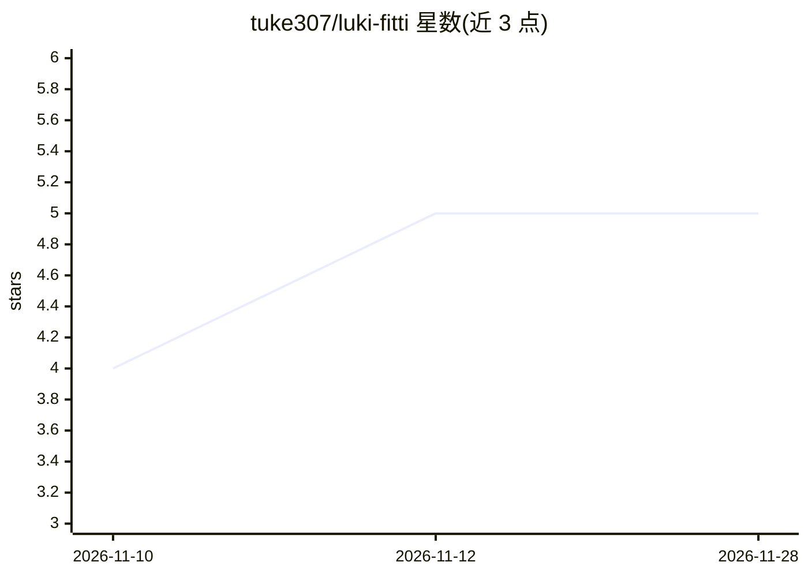

# tuke307/luki-fitti

⭐ 5 · TypeScript · AGPL-3.0 · 推送 2026-11-27 · [GitHub](https://github.com/tuke307/luki-fitti) · [官网](https://luki-fitti.tony-luke.de/) · 组织维护

**面向健身者的开源训练与饮食追踪应用（Web/iPhone/Watch）**

LukiFitti 是一个社区驱动的开源健身与饮食追踪应用，覆盖 Web (PWA)、iPhone 与 Apple Watch，支持离线记录训练组数、休息计时、渐进负荷建议、拉伸流程、热量与宏量营养追踪。2.0 版本加入社交功能：联赛、1v1 对决与每周 Boss 战。AI 相关能力包括：使用用户自己的 OpenRouter key 生成 AI 餐食估算，以及提供公共 API 和面向 AI 助手的 MCP server。支持数据导出与从 GymLife、Alpha Progression 导入，采用 AGPL-3.0 许可并可自托管。

## 筛选速览

| 维度 | 判定 | 备注 |
|---|---|---|
| AI 角色 | `ai-enhanced` | 去掉 AI 部分产品仍成立 |
| 许可风险 | `viral` | AGPL-3.0 |
| 部署形态 | `None` |  |
| 模型依赖 | — | README 未给出锁定关系 |
| 硬件要求 | — | 无带数字的原话,不猜 |
| 安装摩擦 | `low` | 无编译、无系统依赖或容器化 |
| 成熟度 | — | 结构信号不足 |

## 能力要点

- 离线优先的训练记录，覆盖 Web (PWA)、iPhone 与独立 Apple Watch 应用（含心率）
- 基于个人历史的加重量/次数建议
- AI 餐食估算（BYOK，使用自己的 OpenRouter key）
- 公共 API 与 MCP server，支持数据导出与导入

## 适用场景

- 离线记录健身房训练与渐进负荷进度
- 追踪热量与宏量营养摄入并获得 AI 餐食估算
- 与朋友组队参加联赛、对决和 Boss 战
- 自托管并整合到自己的 AI 助手工作流

## 场景标签

 · 领域:健康/健身应用

## 证据(README 行号)

> L18: LukiFitti tracks your workouts, progression, stretching and meals on **Web (PWA)**, **iPhone**
> L28: - **Stretching, meals and body data:** guided routines, calorie and macro tracking, AI meal
> L29:  estimates with your own OpenRouter key.

## 星数曲线

2026-11-10 4 → 2026-11-28 5（+1）

---
*卡片 v1 · prompt 1.4 · 生成 2026-11-21 · 置信度 high · 依据 README sha `301caecba733` · [字段定义](../../DATASET.md)*
