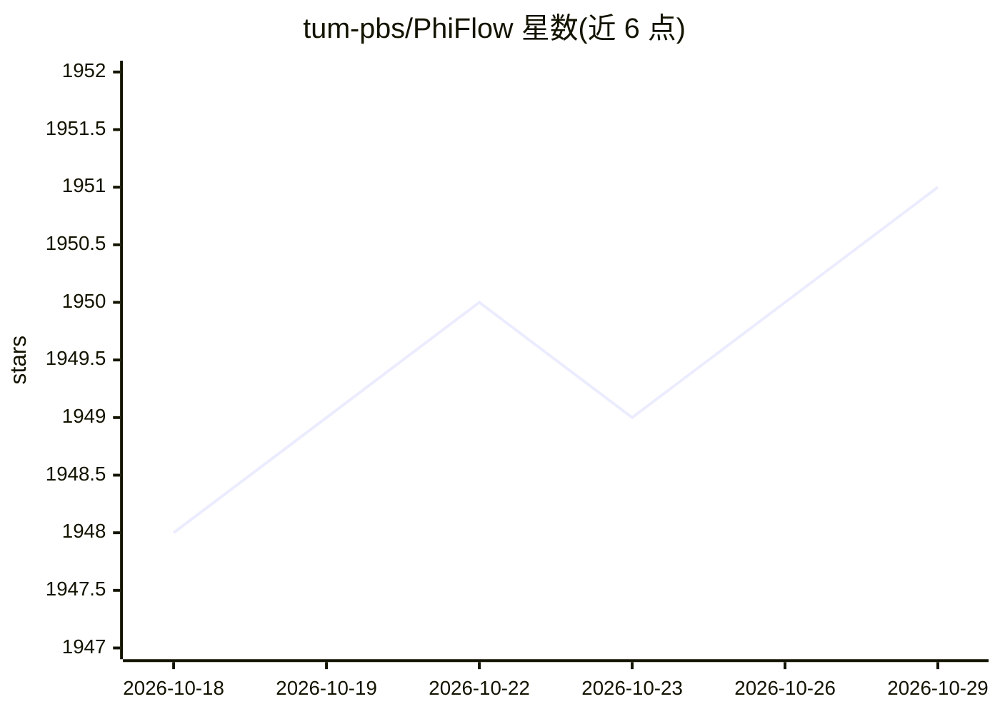

# tum-pbs/PhiFlow

⭐ 1,951 · Python · MIT · 推送 2026-07-16 · [GitHub](https://github.com/tum-pbs/PhiFlow) · 组织维护

**面向机器学习的可微分 PDE/物理仿真框架**

开源仿真工具库，以 Python 编写，支持 NumPy、PyTorch、Jax、TensorFlow 后端，可构建端到端可微分函数，将神经网络训练与物理仿真结合。内置面向流体等物理现象的 PDE 运算、带实时可视化与交互控制的 Web 界面、面向对象向量化设计与自动稀疏矩阵生成的高级线性方程求解器；同一份仿真代码可在不同后端与维度间复用（如 NumPy 2D 与 GPU 3D）。通过 pip 安装，GPU 性能可编译自定义 CUDA 算子；附带 ICLR/NeurIPS 系列论文与文档教程。

## 筛选速览

| 维度 | 判定 | 备注 |
|---|---|---|
| AI 角色 | `ai-native` | 本体是模型或模型工具 |
| 许可风险 | `permissive` | MIT |
| 部署形态 | `library` | 以包/库形式分发 |
| 模型依赖 | — | README 未给出锁定关系 |
| 硬件要求 | — | 无带数字的原话,不猜 |
| 安装摩擦 | `medium` | 含编译或系统依赖之一 |
| 成熟度 | — | 结构信号不足 |

## 能力要点

- 与 PyTorch/Jax/TensorFlow 紧密集成，仿真全程可微分并可运行于 GPU
- 内置 PDE 运算（流体为重点）与自动稀疏矩阵生成的线性方程求解器
- 同一份仿真代码跨后端、跨维度复用
- 带实时可视化与交互控制的 Web 界面

## 适用场景

- 构建可微分物理仿真并与神经网络联合训练
- 求解与优化 PDE 问题（流体、热传导、波浪等）
- 物理仿真研究与教学中的快速原型验证

## 场景标签

 · 领域:科学计算/物理仿真与机器学习

## 证据(README 行号)

> L9: Φ Flow is an open-source simulation toolkit built for optimization and machine learning applications.
> L15: The close integration with these machine learning frameworks allows it to leverage their automatic differentiation 

## 星数曲线

2026-10-18 1,948 → 2026-10-29 1,951（+3）

---
*卡片 v1 · prompt 1.4 · 生成 2026-10-21 · 置信度 high · 依据 README sha `393b4ab5d150` · [字段定义](../../DATASET.md)*
