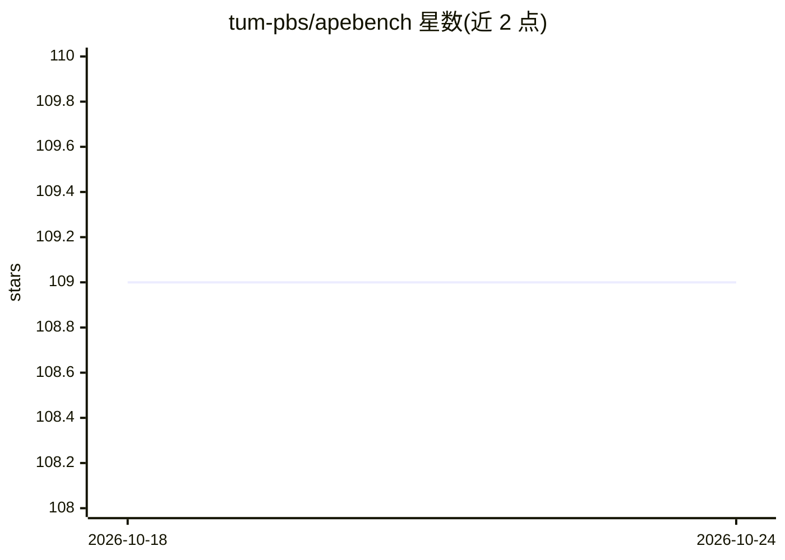

# tum-pbs/apebench

⭐ 109 · Python · MIT · 推送 2026-06-01 · [GitHub](https://github.com/tum-pbs/apebench) · [官网](https://tum-pbs.github.io/apebench/) · 组织维护

**JAX 基础的 PDE 自回归神经模拟器评测基准套件**

面向 1D/2D/3D 周期域 PDE 的自回归神经模拟器（emulator）评测框架：内置基于谱方法的高效参考模拟器，程序化生成数据，无需下载大数据集；支持将模拟器嵌入训练的 solver-in-the-loop 可微物理设置，以及展开训练（unrolled training）与 rollout 误差评测。由 Exponax（参考模拟器）、PDEquinox（网络架构）、Trainax（训练器）三个组件封装为可调用的 scenario dataclass，覆盖训练与评测全流程。NeurIPS 2024 论文配套，pip 安装，需 Python 3.10+ 与 JAX 0.4.12+。

## 筛选速览

| 维度 | 判定 | 备注 |
|---|---|---|
| AI 角色 | `ai-ecosystem` | LLM/agent 周边工具 |
| 许可风险 | `permissive` | MIT |
| 部署形态 | `library` | 以包/库形式分发 |
| 模型依赖 | — | README 未给出锁定关系 |
| 硬件要求 | — | 无带数字的原话,不猜 |
| 安装摩擦 | `medium` | 含编译或系统依赖之一 |
| 成熟度 | — | 结构信号不足 |

## 能力要点

- 谱方法参考模拟器程序化生成数据，无需下载大数据集
- 首个支持可微物理（solver-in-the-loop）的基准套件
- 支持展开训练与多步 rollout 评测指标
- scenario 以可调用 dataclass 封装训练与评测全流程

## 适用场景

- 科研人员系统比较 PDE 神经模拟器的架构与训练设置
- 在自建 PDE 任务上训练并评测 ConvNet/U-Net/FNO 等模型
- 复现 NeurIPS 2024 论文中的基准实验

## 场景标签

 · 领域:科学计算/物理仿真 AI

## 证据(README 行号)

> L32: APEBench is a JAX-based tool to evaluate autoregressive neural emulators for
> L120: APEBench is a framework to holistically assess all four ingredients. Component
> L137: APEBench encapsulates the entire pipeline of training and evaluating an

## 星数曲线

2026-10-18 109 → 2026-10-24 109（+0）

---
*卡片 v1 · prompt 1.4 · 生成 2026-10-23 · 置信度 high · 依据 README sha `88d1462a4b97` · [字段定义](../../DATASET.md)*
