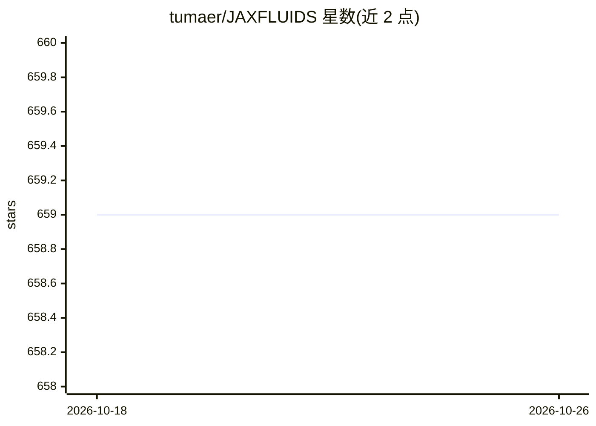

# tumaer/JAXFLUIDS

⭐ 659 · Python · NOASSERTION · 推送 2026-08-28 · [GitHub](https://github.com/tumaer/JAXFLUIDS) · 组织维护

**可微分 CFD 求解器：用 JAX 做 3D 可压缩流仿真与端到端优化**

基于 JAX 编写的全可微分三维 CFD 求解器，用有限体积法在笛卡尔网格上求解可压缩单相/两相流的 Navier-Stokes 方程，面向 ML 与 CFD 交叉领域的研究者。提供高阶 WENO/TENO 重构、多种 Riemann 求解器、level-set 与扩散界面两相方法、浸入式固体边界等数值方法；通过自动微分支持对数值模型的端到端优化，可在 CPU/GPU/TPU 上运行并在 HPC 集群并行（测试过 512 块 A100 与 2048 个 TPU-v3 核心）。以 pip 安装的 Python 包形式提供，附带五个入门 notebook。

## 筛选速览

| 维度 | 判定 | 备注 |
|---|---|---|
| AI 角色 | `ai-ecosystem` | LLM/agent 周边工具 |
| 许可风险 | `none` | NOASSERTION |
| 部署形态 | `library` | 以包/库形式分发 |
| 模型依赖 | — | README 未给出锁定关系 |
| 硬件要求 | `cpu-ok` | |
| 安装摩擦 | `medium` | 含编译或系统依赖之一 |
| 成熟度 | — | 结构信号不足 |

## 能力要点

- 全可微分求解器，支持数值模型的端到端梯度优化
- CPU/GPU/TPU 运行与并行扩展（测试至 512 A100 / 2048 TPU-v3 核心）
- 高阶重构（WENO-3/5/7、TENO 等）与多种 Riemann 求解器
- level-set 与扩散界面方法支持两相流及浸入式边界

## 适用场景

- 运行激波管、激波-气泡作用等可压缩流仿真
- 利用自动微分对数值格式做端到端优化研究
- 在大规模 GPU/TPU 集群上做大规模两相流计算

## 场景标签

 · 领域:计算流体力学/科学计算

## 证据(README 行号)

> L3: JAX-Fluids is a fully-differentiable CFD solver for 3D, compressible single-phase and two-phase flows.
> L4: We developed this package with the intention to facilitate research at the intersection
> L7: enables automatic differentiation for end-to-end optimization

## 星数曲线

2026-10-18 659 → 2026-10-26 659（+0）

---
*卡片 v1 · prompt 1.4 · 生成 2026-10-21 · 置信度 high · 依据 README sha `9e9b019eb7da` · [字段定义](../../DATASET.md)*
