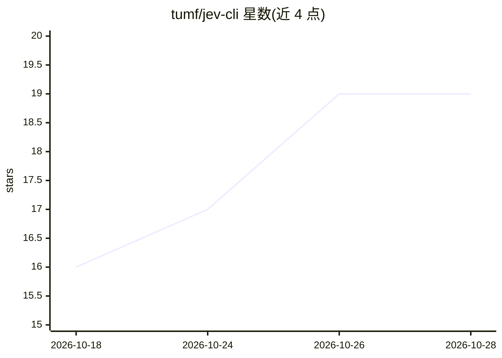

# tumf/jev-cli

⭐ 19 · Python · MIT · 推送 2026-10-06 · [GitHub](https://github.com/tumf/jev-cli) · [官网](https://docs.typesafe.ai/introduction) · 个人维护

**调用 TypeSafe Jev API 的类型化判断 CLI 与 MCP 服务器**

面向需要在应用代码中获得快速分类或判断而非生成文本的开发者的命令行工具：jev 命令发送文本或 JSON 状态并提出类型化问题（noul 是非概率、choice 选项选择、score 有序评分），返回机器可读 JSON；jev-mcp 以 stdio MCP 服务器形式向 MCP 主机暴露同样能力。支持批量请求、文件/stdin/JSON 输入、多 provider（TypeSafe 官方、Vercel AI Gateway、OpenRouter、自定义代理、Cloudflare Workers AI）与结构化错误与退出码。需自备 provider API key，通过 PyPI 以 uv tool 安装。

## 筛选速览

| 维度 | 判定 | 备注 |
|---|---|---|
| AI 角色 | `ai-ecosystem` | LLM/agent 周边工具 |
| 许可风险 | `permissive` | MIT |
| 部署形态 | `library` | 以包/库形式分发 |
| 模型依赖 | locked-api |  |
| 硬件要求 | — | 无带数字的原话,不猜 |
| 安装摩擦 | `low` | 无编译、无系统依赖或容器化 |
| 成熟度 | — | 结构信号不足 |

## 能力要点

- noul/choice/score 三种类型化判断原语
- 同一安装附带 stdio MCP 服务器 jev-mcp（四个工具）
- 五种 provider 可切换（官方/Vercel/OpenRouter/自定义代理/Cloudflare）
- run 命令单请求发送多问题，独立求值

## 适用场景

- 在 shell 脚本中对消息做紧急度等是/否判断并按阈值分支
- 让 MCP 主机（如 Claude 类 agent）调用类型化判断工具
- 对工单或客户反馈做选项归类与程度评分

## 场景标签

 · 领域:LLM 工具/分类判断

## 证据(README 行号)

> L5: A small CLI and stdio MCP server for TypeSafe Jev. Send text or JSON state, ask typed questions, and receive machine
> L7: The `jev` command is useful when application code needs a fast classification or judgment instead of generated prose

## 星数曲线

2026-10-18 16 → 2026-10-28 19（+3）

---
*卡片 v1 · prompt 1.4 · 生成 2026-10-28 · 置信度 high · 依据 README sha `30b165bbe5f9` · [字段定义](../../DATASET.md)*
