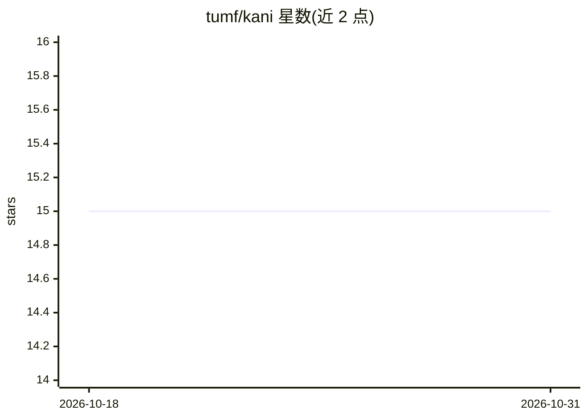

# tumf/kani

⭐ 15 · Python · 推送 2026-06-24 · [GitHub](https://github.com/tumf/kani) · 个人维护

**按提示复杂度自动选路到最优模型的 OpenAI 兼容本地代理**

面向开发者的 LLM 智能路由代理：以 OpenAI 兼容 API 接收请求，通过蒸馏特征分类器（tokenCount + 14 个学习到的语义维度）计算复杂度与推理分数，将请求划入 SIMPLE/MEDIUM/COMPLEX/REASONING 四档并路由到对应模型，简单请求可走更便宜的模型以控制成本。运行时路由不调用 LLM。支持 OpenAI、OpenRouter 及本地代理等上游，具备能力感知过滤（vision/tools/json_mode）、可选上下文压缩、配置热重载、代理鉴权、路由日志与分类器再训练脚本。需 Python 3.13+ 与 uv，模型 ID 按上游原样发送不重写。

## 筛选速览

| 维度 | 判定 | 备注 |
|---|---|---|
| AI 角色 | `ai-ecosystem` | LLM/agent 周边工具 |
| 许可风险 | `permissive` | — |
| 部署形态 | `None` |  |
| 模型依赖 | locked-api |  |
| 硬件要求 | — | 无带数字的原话,不猜 |
| 安装摩擦 | `low` | 无编译、无系统依赖或容器化 |
| 成熟度 | — | 结构信号不足 |

## 能力要点

- 蒸馏特征分类器输出四档分级（SIMPLE/MEDIUM/COMPLEX/REASONING），运行时不调用 LLM
- 能力感知路由：自动检测 vision/tools/json_mode 需求并逐级升级模型
- 四个内置 profile（auto/eco/premium/agentic），OpenAI API 直换 base_url 即可用
- 可选上下文压缩、SQLite 持久化、路由 JSONL 日志与分类器训练脚本

## 适用场景

- 用单一 OpenAI 兼容端点统一接入 OpenAI/OpenRouter 等多上游，简单请求自动走便宜模型降本
- 让 LangChain、Cursor 等支持 OpenAI API 的现有工具不改代码获得智能路由
- 通过 /v1/route 与 X-Kani-* 响应头检查和调试路由决策

## 场景标签

`模型网关` · 领域:Agent 开发

## 证据(README 行号)

> L8: kani is an OpenAI-compatible local proxy that automatically routes LLM requests to the most suitable model.
> L244: Request → Distilled Feature Classifier → Tier + Agentic Score → Capability Filter → Model Selection → Upstream Pro
> L257: Runtime routing does not call an LLM. LLM usage is limited to optional offline dataset annotation.

## 星数曲线

2026-10-18 15 → 2026-10-31 15（+0）

---
*卡片 v1 · prompt 1.4 · 生成 2026-10-30 · 置信度 high · 依据 README sha `ac64c65c37ec` · [字段定义](../../DATASET.md)*
