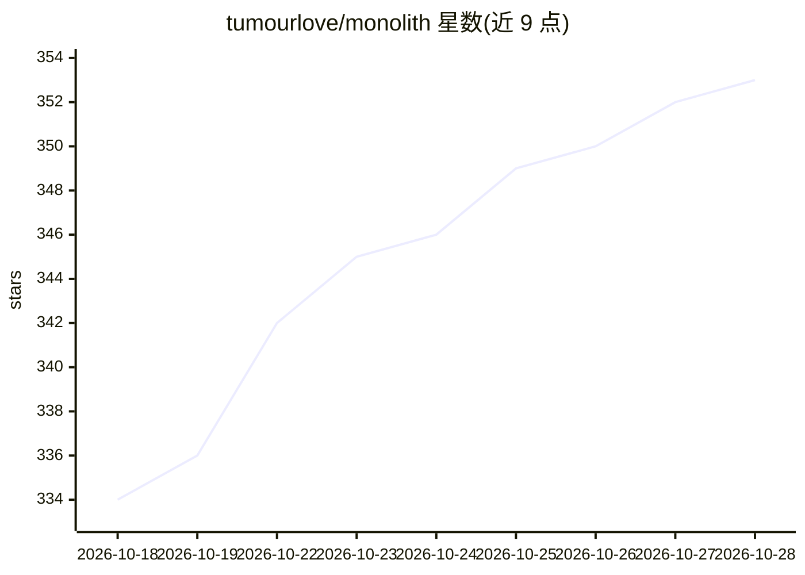

# tumourlove/monolith

⭐ 355 · C++ · MIT · 推送 2026-10-18 · [GitHub](https://github.com/tumourlove/monolith) · [官网](https://github.com/tumourlove/monolith/wiki) · 个人维护

**给 UE 5.7/5.8 的 MCP 插件：让 AI 助手读写引擎各域资产**

面向 Unreal Engine 5.7/5.8 的 MCP 插件，向 Claude Code、Cursor、Cline 等 MCP 客户端暴露约 1,400+ 个动作，覆盖蓝图、材质、Niagara、动画、网格、UI、AI、GAS 等 26 个命名空间。采用命名空间分发模式，用少量 {namespace}_query 工具替代上千个独立工具以节省上下文；附 Reflection Intelligence 层（决策记录/风险/反射查询）与离线查询可执行文件。安装为放入 Plugins 目录并配置 .mcp.json，本地 HTTP 服务器监听 9316 端口且绑定所有网卡。

## 筛选速览

| 维度 | 判定 | 备注 |
|---|---|---|
| AI 角色 | `ai-ecosystem` | LLM/agent 周边工具 |
| 许可风险 | `permissive` | MIT |
| 部署形态 | `desktop` | 安装包/桌面程序 |
| 模型依赖 | — | README 未给出锁定关系 |
| 硬件要求 | — | 无带数字的原话,不猜 |
| 安装摩擦 | `low` | 无编译、无系统依赖或容器化 |
| 成熟度 | — | 结构信号不足 |

## 能力要点

- ~1,400+ 动作覆盖 26 个引擎命名空间（蓝图/材质/Niagara/GAS 等）
- 命名空间分发模式：少量 query 工具替代上千独立工具
- Reflection Intelligence：decision/risk/cppreflect/network 复制审查
- 附带离线查询工具 monolith_query.exe，无需启动编辑器

## 适用场景

- 让 Claude Code/Cursor 等 AI 客户端直接操作 UE 项目资产
- 在 CI 或编辑器关闭时离线查询引擎源码索引与项目资产索引
- 用 AI 做架构决策与复制/RPC 审查

## 场景标签

 · 领域:游戏引擎/AI 工具集成

## 证据(README 行号)

> L7: MCP
> L19: Monolith exposes **~1,400+ actions across 26 in-tree namespaces** through a namespace-dispatch pattern: each domain
> L35: Works with **Claude Code**, **Cursor**, **Cline**, or any MCP-compatible client. Windows, macOS, Linux.

## 星数曲线

2026-10-18 334 → 2026-10-28 353（+19）

---
*卡片 v1 · prompt 1.4 · 生成 2026-10-21 · 置信度 high · 依据 README sha `31679a564c7c` · [字段定义](../../DATASET.md)*
