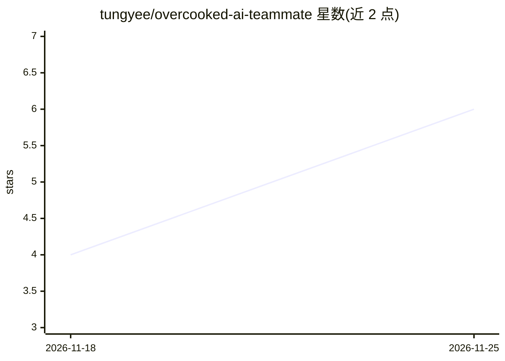

# tungyee/overcooked-ai-teammate

⭐ 6 · Python · MIT · 推送 2026-11-22 · [GitHub](https://github.com/tungyee/overcooked-ai-teammate) · 个人维护 · 中文 README

**Overcooked! 2 的实时 AI 队友：边做菜边听懂语音指令**

CoChef 以虚拟手柄身份作为 Player 2 加入 Overcooked! 2 本地双人合作，与玩家共同完成切菜、烹饪、上菜。架构分两层：System 1 决策引擎用效用模型对任务打分、以行为树通过虚拟手柄执行具体动作；System 2 LLM 在厨房局面语境下理解语音请求、协调分工并以中文（普通话）语音答复。需要 Steam 版游戏本体、Python 3.9+，以及一次性平台设置（游戏插件 BepInEx、Python 环境、语音 API 凭据、音频权限），目前支持 macOS 与 Windows。

## 筛选速览

| 维度 | 判定 | 备注 |
|---|---|---|
| AI 角色 | `ai-native` | 本体是模型或模型工具 |
| 许可风险 | `permissive` | MIT |
| 部署形态 | `desktop` | 安装包/桌面程序 |
| 模型依赖 | — | README 未给出锁定关系 |
| 硬件要求 | — | 无带数字的原话,不猜 |
| 安装摩擦 | `low` | 无编译、无系统依赖或容器化 |
| 成熟度 | — | 结构信号不足 |

## 能力要点

- System 1 行为树+效用模型实时执行烹饪任务
- System 2 LLM 理解语音请求并协调分工、语音答复
- 通过虚拟手柄以 Player 2 身份加入本地合作
- F8 按键说话的 push-to-talk 交互

## 适用场景

- 线下没有朋友时找 AI 队友一起玩本地双人模式
- 游戏中途用语音把洗碗、煮饭等任务交给队友
- 剧情模式推进中让队友按厨房布局变化调整走位

## 场景标签

`语音 Agent` · 领域:对话与助手

## 证据(README 行号)

> L7: > An AI teammate for Overcooked! 2 that chops, cooks, and serves alongside you in real time and understands spoken r
> L18: - **System 2 (LLM)** interprets your requests in the context of what’s happening in the kitchen, coordinates who do
> L19: - **System 1 (decision engine)** uses a utility model to score available tasks and a behavior tree to carry out the

## 星数曲线

2026-11-18 4 → 2026-11-25 6（+2）

---
*卡片 v1 · prompt 1.4 · 生成 2026-11-21 · 置信度 mid · 依据 README sha `65f1e956d88a` · [字段定义](../../DATASET.md)*
