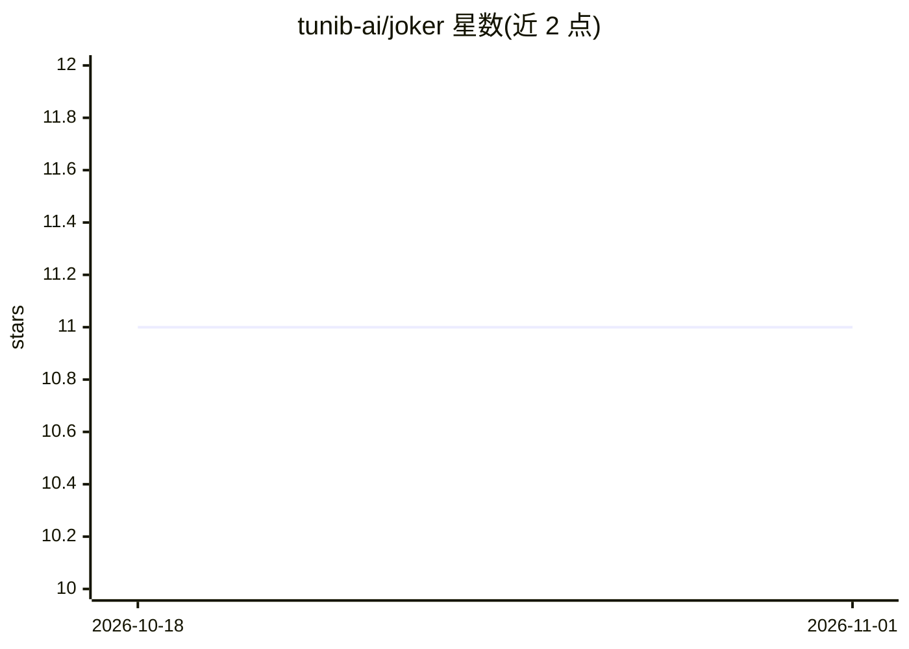

# tunib-ai/joker

⭐ 11 · Python · 推送 2026-02-09 · [GitHub](https://github.com/tunib-ai/joker) · [官网](https://huggingface.co/tunib/llama-3-joker) · 组织维护

**面向开发者与科研：自动化测试 LLM 伦理攻击防御的韩语模型**

基于 Meta LLaMA-3 8B 微调的 AI 模型，用韩国 AI Hub 的文本伦理验证数据（含大量仇恨言论示例）训练，用于模拟外部伦理攻击以替代人工撰写侮辱性输入，测试生成式模型在韩语下的安全表现：用户只需评估被测模型的回应。权重通过 Hugging Face 发布，仅向通过审批的组织开放，不对个人提供。安装需在含 PyTorch/CUDA 的 conda 环境中克隆仓库并 pip install -e .，运行 example.py 交互。使用违反社会规范时责任由用户承担。

## 筛选速览

| 维度 | 判定 | 备注 |
|---|---|---|
| AI 角色 | `ai-native` | 本体是模型或模型工具 |
| 许可风险 | `none` | — |
| 部署形态 | `library` | 以包/库形式分发 |
| 模型依赖 | — | README 未给出锁定关系 |
| 硬件要求 | — | 无带数字的原话,不猜 |
| 安装摩擦 | `medium` | 含编译或系统依赖之一 |
| 成熟度 | — | 结构信号不足 |

## 能力要点

- 用仇恨言论数据集微调 LLaMA-3 8B，模拟外部伦理攻击
- 自动化替代人工安全评估中撰写攻击输入的环节
- 聚焦韩语文本的安全测试
- 权重仅对通过 Hugging Face 审批的组织开放

## 适用场景

- 自动化测试我的 LLM 对韩语伦理攻击的防御能力
- 安全研究中替代人工撰写侮辱性测试输入
- 评估模型回应后只做人工判定，减少评估者的心理消耗

## 场景标签

`科研工具` `模型评测` · 领域:评测与运维

## 证据(README 行号)

> L9: LLaMA-3 Joker is designed to test how effectively a generative AI model handles external ethical attacks in the Kore
> L11: In the past few years, there has been a significant push towards ensuring the safety and ethical behavior of LLM mo
> L15: We fine-tuned the checkpoint of Meta's publicly released LLaMA-3 model (8B) with the

## 星数曲线

2026-10-18 11 → 2026-11-01 11（+0）

---
*卡片 v1 · prompt 1.4 · 生成 2026-11-01 · 置信度 high · 依据 README sha `b739e214a33f` · [字段定义](../../DATASET.md)*
