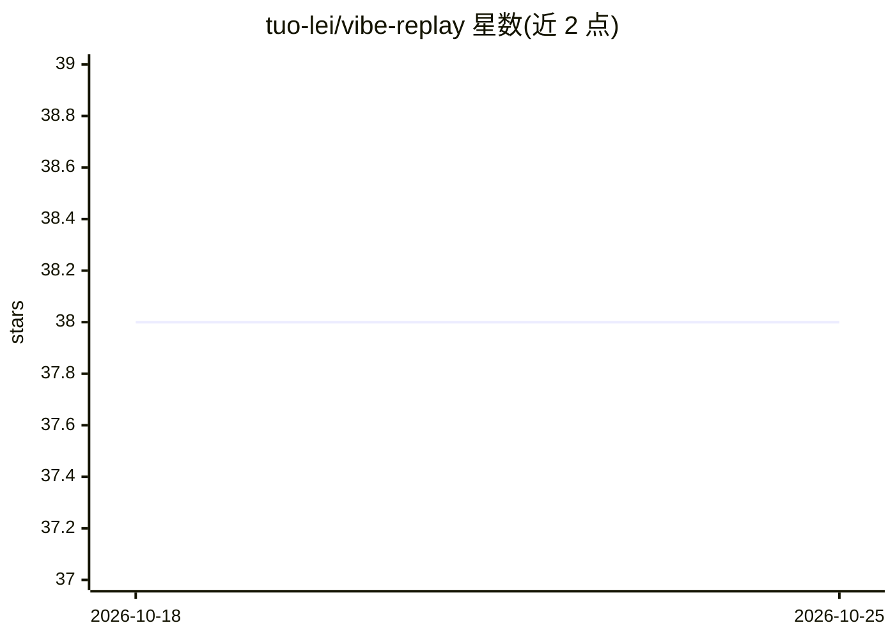

# tuo-lei/vibe-replay

⭐ 38 · TypeScript · MIT · 推送 2026-10-24 · [GitHub](https://github.com/tuo-lei/vibe-replay) · [官网](https://vibe-replay.com) · 个人维护

**把 AI 编程会话转为可分享动画回放并做用量分析**

面向使用 Claude Code、Cursor、Codex 等 AI 编程工具的开发者：npx 一条命令读取本地 JSONL 会话，生成自包含的交互式 HTML 回放文件，含逐条 prompt、思考块、工具调用与代码 diff 的动画播放；提供本地 dashboard 浏览全部会话、活动热图、token/成本分析；支持远程 SSH 源接入与端到端加密的 relay 只读实时分享；可作为 Claude Code 插件让 agent 自主生成回放并嵌入 PR。限制：relay 为 MVP 且只读，分享 URL 即凭据。

## 筛选速览

| 维度 | 判定 | 备注 |
|---|---|---|
| AI 角色 | `ai-ecosystem` | LLM/agent 周边工具 |
| 许可风险 | `permissive` | MIT |
| 部署形态 | `library` | 以包/库形式分发 |
| 模型依赖 | — | README 未给出锁定关系 |
| 硬件要求 | — | 无带数字的原话,不猜 |
| 安装摩擦 | `low` | 无编译、无系统依赖或容器化 |
| 成熟度 | `idea` | |

## 能力要点

- 单条 npx 命令生成自包含交互式 HTML 回放
- 本地 dashboard：会话搜索、活动热图、token/成本/工具调用分析
- vibe-replay relay：无需入站端口、端到端加密的只读实时分享
- Claude Code 插件与 Agent Skills（SKILL.md）安装，agent 可自主生成 PR 回放产物

## 适用场景

- 把我的 AI 编程会话做成动画回放放进 PR 供评审理解改动缘由
- 跨项目浏览和检索所有 Claude/Cursor/Codex 会话并统计成本
- 从手机只读查看远程机器上的进行中会话

## 场景标签

 · 领域:开发者工具/AI 会话分析

## 证据(README 行号)

> L7: Turn Claude, Cursor, Codex, OpenCode, Hermes, Muse, Pi, and Grok Bot sessions into shareable, interactive replays — 
> L15: One command. One self-contained HTML file. Every prompt, every thought, every tool call — animated, searchable, and
> L124: Go beyond playback without sending your session history to a hosted service. **AI Studio** uses the

## 星数曲线

2026-10-18 38 → 2026-10-25 38（+0）

---
*卡片 v1 · prompt 1.4 · 生成 2026-10-25 · 置信度 high · 依据 README sha `084a22fc35b3` · [字段定义](../../DATASET.md)*
