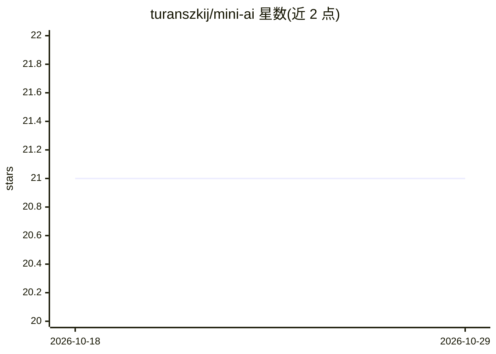

# turanszkij/mini-ai

⭐ 21 · C++ · 推送 2026-08-22 · [GitHub](https://github.com/turanszkij/mini-ai) · 个人维护

**本地运行多模态 AI 生成的 Windows 图形小应用**

用 C++ 和 WinAPI 编写的轻量 Windows 桌面程序，无外部依赖。支持文生图（Z-Image、Flux 2、SD3.5 Large、Qwen Image、ERNIE-Image Turbo）、图像编辑（Flux 2、Qwen Image Edit）、文本问答（Qwen 3 VL、Gemma 4）与文生视频（Wan 2.2、LTX 2.3、Minimax H3）。首次使用时自动从网络下载所选模式对应的模型（常达数 GB）到 models/ 目录；生成结果保存到 output/。底层使用 stable-diffusion.cpp 与 llama.cpp。构建需 Visual Studio C++ build tools 运行 build.bat。

## 筛选速览

| 维度 | 判定 | 备注 |
|---|---|---|
| AI 角色 | `ai-native` | 本体是模型或模型工具 |
| 许可风险 | `none` | — |
| 部署形态 | `None` |  |
| 模型依赖 | — | README 未给出锁定关系 |
| 硬件要求 | — | 无带数字的原话,不猜 |
| 安装摩擦 | `low` | 无编译、无系统依赖或容器化 |
| 成熟度 | — | 结构信号不足 |

## 能力要点

- 文生图、图像编辑、问答、文生视频四种模式，可在下拉菜单切换
- 首次使用自动下载所选模型到 models/ 文件夹
- 支持复制粘贴、撤销重做、调整窗口设定分辨率、多种图片格式（PNG/JPG/TGA/HEIC/ICO）
- C++/WinAPI 实现，无外部依赖，底层为 stable-diffusion.cpp 与 llama.cpp

## 适用场景

- 在本机离线跑文生图或文生视频，不想装繁琐环境
- 用提示词编辑现有图片
- 带参考图提问，获取本地模型回答

## 场景标签

`图像生成` `视频生成` `聊天机器人` · 领域:对话与助手

## 证据(README 行号)

> L2: A tiny graphical application for running simple AI generation tasks locally on your machine.
> L7: - Image generation: You simply type a text and the image will be generated.
> L20: - Video: generate a video from text prompt, and/or from the reference images

## 星数曲线

2026-10-18 21 → 2026-10-29 21（+0）

---
*卡片 v1 · prompt 1.4 · 生成 2026-10-28 · 置信度 high · 依据 README sha `4af77d13b7c2` · [字段定义](../../DATASET.md)*
