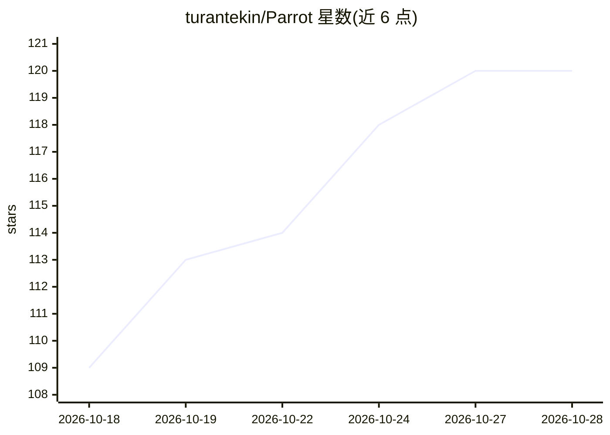

# turantekin/Parrot

⭐ 122 · Swift · GPL-3.0 · 推送 2026-10-16 · [GitHub](https://github.com/turantekin/Parrot) · [官网](https://openparrot.app) · 个人维护

**Mac 本地优先的会议录制器：通话中实时转写并给出 AI 助答**

原生 SwiftUI 的 macOS 应用（GPL-3.0，需 macOS 14+ Apple Silicon），录制并转写 Mac 上听到的任何通话（Meet/Zoom/Teams 等，无机器人入会），转写、说话人分离（FluidAudio 13MB 本地模型）与文档嵌入（NaturalLanguage 框架 + BM25 索引）均在本地完成。通话中实时给出基于自有文档的建议回答、实时提示与评分，通话后自动生成报告与教练分析。AI 后端可选 Claude、任意 OpenAI 兼容服务或 Ollama 本地模型；支持一键接入 Claude Desktop/Claude Code 等，Ask Parrot 功能尚处 beta。

## 筛选速览

| 维度 | 判定 | 备注 |
|---|---|---|
| AI 角色 | `ai-native` | 本体是模型或模型工具 |
| 许可风险 | `viral` | GPL-3.0 |
| 部署形态 | `desktop` | 安装包/桌面程序 |
| 模型依赖 | local-ok | 支持本地模型 |
| 硬件要求 | — | 无带数字的原话,不猜 |
| 安装摩擦 | `medium` | 含编译或系统依赖之一 |
| 成熟度 | `idea` | |

## 能力要点

- 转写、说话人分离与文档检索全部在本地完成，不上传音频
- 通话中基于自有文档（PDF/文本/Markdown）实时给出建议回答与实时提示
- AI 后端可选 Claude / OpenAI 兼容服务 / Ollama 本地模型
- 八种通话场景内置档案，自动生成报告、承诺追踪与教练分析

## 适用场景

- 在销售或客户通话中实时获得来自自己文档的回答建议
- 本地录制并转写会议，通话后自动生成带时间戳引用的报告
- 通过 Claude Desktop 等 MCP 客户端检索和复用历史会议内容

## 场景标签

`语音识别` `AI 助手` · 领域:对话与助手

## 证据(README 行号)

> L16: **A meeting recorder for your Mac with a live AI assistant built in. It records and transcribes every call on your 
> L18: No bot joins your meeting. It works with Google Meet, Zoom, Teams, or anything else your Mac can hear. Transcriptio
> L59: - Drop in PDFs, text or Markdown: pricing sheets, FAQs, playbooks. They're chunked and embedded **on your Mac** wit

## 星数曲线

2026-10-18 109 → 2026-10-28 120（+11）

---
*卡片 v1 · prompt 1.4 · 生成 2026-10-23 · 置信度 high · 依据 README sha `ae3dd3c2a540` · [字段定义](../../DATASET.md)*
