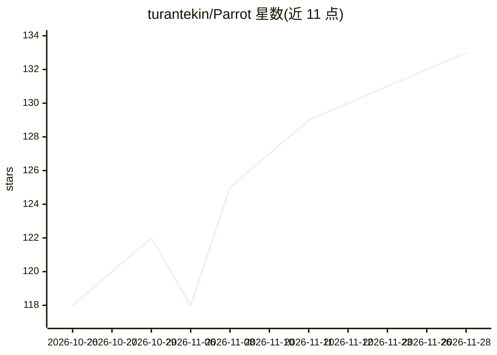

# turantekin/Parrot

⭐ 133 · Swift · GPL-3.0 · 推送 2026-11-25 · [GitHub](https://github.com/turantekin/Parrot) · [官网](https://openparrot.app) · 个人维护

**Mac 上的会议录音器，通话中实时给出 AI 助手回答**

运行在 Mac（Apple Silicon、macOS 14+）上的 SwiftUI 原生会议录音应用：录制并本机转录任意通话（Google Meet/Zoom/Teams 等，无需会议机器人加入），通话中根据用户自己的文档实时给出建议回答、生成会后报告、做说话人分离与命名，并通过 Ask Parrot 对全部历史通话提问。知识库文档在本机用 Apple NaturalLanguage 框架嵌入并建 BM25 索引，仅匹配片段发送给所选 AI。助手模型可选 Claude（自带 key）、OpenAI 兼容服务器或经 Ollama 的本地模型。以 GPL-3.0 开源，提供下载安装包。

## 筛选速览

| 维度 | 判定 | 备注 |
|---|---|---|
| AI 角色 | `ai-native` | 本体是模型或模型工具 |
| 许可风险 | `viral` | GPL-3.0 |
| 部署形态 | `desktop` | 安装包/桌面程序 |
| 模型依赖 | local-ok | 支持本地模型 |
| 硬件要求 | — | 无带数字的原话,不猜 |
| 安装摩擦 | `medium` | 含编译或系统依赖之一 |
| 成熟度 | `idea` | |

## 能力要点

- 通话中的实时助手：基于本地文档的建议回答、钉住卡片、通话评分与提醒
- 本机转录与说话人分离（FluidAudio 13MB 模型），文档嵌入不出本机
- 连接 Claude Desktop/Claude Code/Cursor 等读取会议数据（MCP 方式）
- 8 种内置通话画像，每种生成对应结构的会后报告与评分卡

## 适用场景

- 销售/访谈等通话中实时获取基于自家文档的回答
- 会后自动生成带时间戳引用的报告与跟进邮件
- 用 Claude 或本地模型对历史会议记录提问

## 场景标签

`AI 助手` `语音识别` `文档问答` · 领域:对话与助手

## 证据(README 行号)

> L16: **A meeting recorder for your Mac with a live AI assistant built in. It records and transcribes every call on your 
> L18: No bot joins your meeting. It works with Google Meet, Zoom, Teams, or anything else your Mac can hear. Transcriptio

## 星数曲线

2026-10-26 118 → 2026-11-28 133（+15）

---
*卡片 v1 · prompt 1.4 · 生成 2026-11-28 · 置信度 high · 依据 README sha `5fc9b4950dd8` · [字段定义](../../DATASET.md)*
