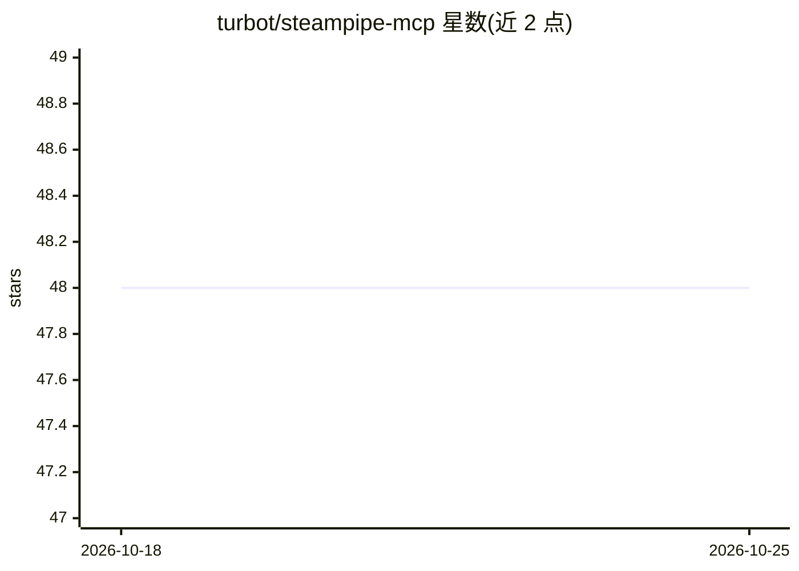

# turbot/steampipe-mcp

⭐ 48 · TypeScript · Apache-2.0 · 推送 2026-03-01 · [GitHub](https://github.com/turbot/steampipe-mcp) · 组织维护

**让 AI 助手用自然语言查询云基础设施数据的 MCP 服务器**

由 Turbot 维护的 Model Context Protocol 服务器，将 Claude Desktop、Cursor 等 AI 助手连接到 Steampipe 数据：跨 AWS、Azure、GCP 等 100+ 云服务执行只读 SQL 查询，支持安全合规分析、成本与资源优化。提供 5 个工具（查询、表列表/详情、插件列表/详情）、best_practices 提示与连接状态资源。兼容本地 Steampipe 安装与 Turbot Pipes 工作区，需 Node.js v16+，通过 npx 运行。仓库采用 Apache 2.0 许可。

## 筛选速览

| 维度 | 判定 | 备注 |
|---|---|---|
| AI 角色 | `ai-ecosystem` | LLM/agent 周边工具 |
| 许可风险 | `permissive` | Apache-2.0 |
| 部署形态 | `library` | 以包/库形式分发 |
| 模型依赖 | — | README 未给出锁定关系 |
| 硬件要求 | — | 无带数字的原话,不猜 |
| 安装摩擦 | `low` | 无编译、无系统依赖或容器化 |
| 成熟度 | — | 结构信号不足 |

## 能力要点

- 5 个 MCP 工具：SQL 查询（只读 PostgreSQL 语法）、表与插件元数据查询
- 覆盖 AWS、Azure、GCP 等 100+ 云服务的自然语言查询
- 内置 best_practices 提示指导 LLM 高效使用 Steampipe
- 支持本地 Steampipe 与 Turbot Pipes 工作区两种连接方式

## 适用场景

- 让 Claude 等 AI 助手用自然语言查询我的云资源清单
- 通过对话做云基础设施的安全与合规检查
- 生成 EC2/S3/IAM 等资源的分析报告

## 场景标签

`数据分析` `网络安全` · 领域:效率与自动化

## 证据(README 行号)

> L3: Unlock the power of AI-driven infrastructure analysis with Steampipe! This Model Context Protocol server seamlessly 
> L5: Steampipe MCP bridges AI assistants and your infrastructure data, allowing natural language:
> L97: - **steampipe_query**

## 星数曲线

2026-10-18 48 → 2026-10-25 48（+0）

---
*卡片 v1 · prompt 1.4 · 生成 2026-10-25 · 置信度 high · 依据 README sha `f5c3e67f49fe` · [字段定义](../../DATASET.md)*
