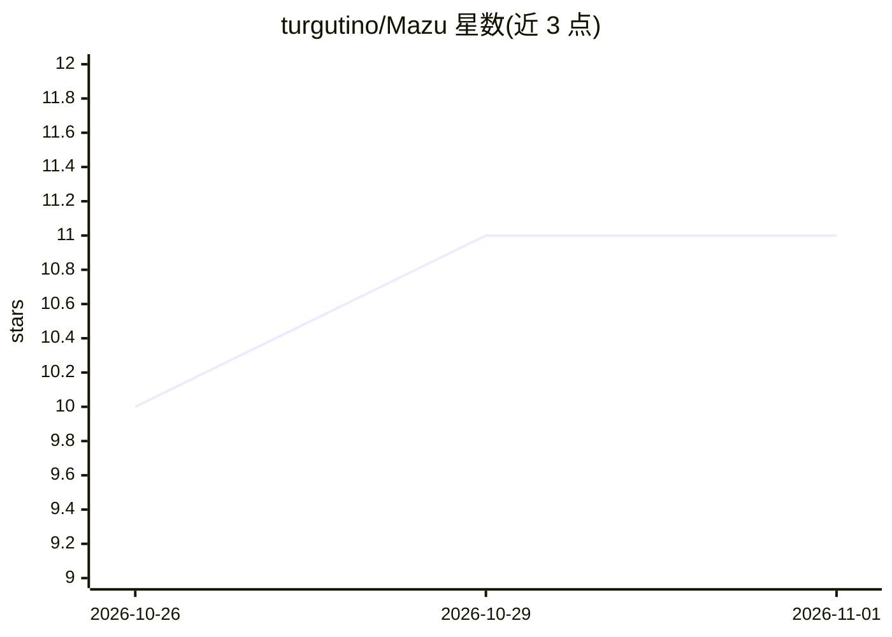

# turgutino/Mazu

⭐ 11 · Python · MIT · 推送 2026-10-27 · [GitHub](https://github.com/turgutino/Mazu) · 个人维护

**本地运行的记忆增强编码 agent：持久记忆、检查点与成本控制**

命令行编码 agent，提供交互式 `mazu chat` 与无人值守 `mazu run` 两种模式，可读改文件、执行 shell 命令。核心机制：项目决策与错误存入本地 SQLite，用 BM25（可选混合嵌入）检索注入上下文；每步将代码、记忆库、技能与会话一起打快照，支持 rollback 与分支回溯；`--max-cost` 限定会话估算花费。支持 Anthropic/OpenAI/DeepSeek/Gemini 或本地 OpenAI 兼容服务，自带基准测试（`mazu bench`）报告通过率与置信区间。自述为 alpha 软件。

## 筛选速览

| 维度 | 判定 | 备注 |
|---|---|---|
| AI 角色 | `ai-native` | 本体是模型或模型工具 |
| 许可风险 | `permissive` | MIT |
| 部署形态 | `library` | 以包/库形式分发 |
| 模型依赖 | local-ok | 支持本地模型 |
| 硬件要求 | — | 无带数字的原话,不猜 |
| 安装摩擦 | `low` | 无编译、无系统依赖或容器化 |
| 成熟度 | `idea` | |

## 能力要点

- 跨会话持久项目记忆，BM25 检索注入上下文
- 代码+记忆+会话一体检查点，rollback/timeline/分支恢复
- 多模型并行 explore/council 与成本上限
- 内置基准套件，报告通过率与 Wilson 置信区间

## 适用场景

- 长周期项目中让 agent 记住决策与约定
- 无人值守跑任务并可回滚错误修改
- 对比多个模型在自己项目上的表现与成本

## 场景标签

`编码 Agent` · 领域:编码与开发

## 证据(README 行号)

> L5: **A local coding agent with persistent project memory, rollback, cost limits, and a built-in way to measure itself.*
> L20: - **Chat or run unattended.** `mazu chat` is an interactive agent that can read and edit files and run shell comman

## 星数曲线

2026-10-26 10 → 2026-11-01 11（+1）

---
*卡片 v1 · prompt 1.4 · 生成 2026-11-01 · 置信度 high · 依据 README sha `5302ba70a146` · [字段定义](../../DATASET.md)*
