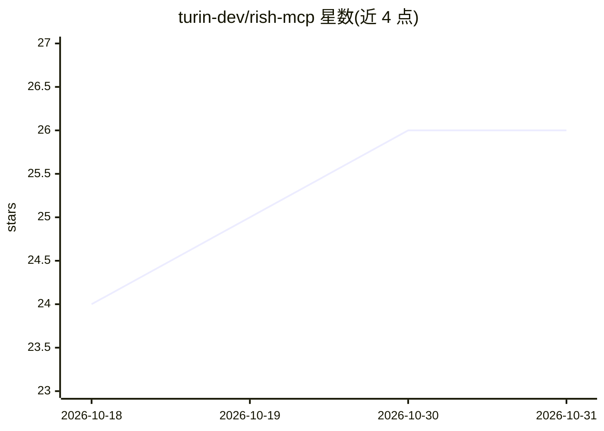

# turin-dev/rish-mcp

⭐ 26 · Go · MIT · 推送 2026-10-12 · [GitHub](https://github.com/turin-dev/rish-mcp) · 个人维护 · 中文 README

**让 AI 客户端经 MCP 远程访问 Android 设备 shell 的自托管中继**

由 Android Kotlin agent、Go 中继（MCP over Streamable HTTP + WebSocket）和 npm 安装工具组成：手机端以仅出站 WebSocket 连接到用户自托管的中继，无需 root、Shizuku 或公网入站端口，AI 客户端用 bearer token 经 MCP 调用 list_devices 与 run_shell，以 shell uid 2000 执行命令。定位为单用户/机主自用，非多租户设备平台；当前重写版处于 preview 阶段，Android UI 尚未完成真机稳定性验收。

## 筛选速览

| 维度 | 判定 | 备注 |
|---|---|---|
| AI 角色 | `ai-ecosystem` | LLM/agent 周边工具 |
| 许可风险 | `permissive` | MIT |
| 部署形态 | `self-host` | docker 或自建部署 |
| 模型依赖 | — | README 未给出锁定关系 |
| 硬件要求 | — | 无带数字的原话,不猜 |
| 安装摩擦 | `low` | 无编译、无系统依赖或容器化 |
| 成熟度 | `idea` | |

## 能力要点

- 仅出站 WebSocket 连接，设备无需开放入站端口，可在 NAT/CGNAT 后工作
- 无需 root 与 Shizuku，直接与设备自身 adbd 配对（Android 11+ 无线调试）
- 提供 list_devices 与 run_shell 两个 MCP 工具，命令以 shell uid 2000 执行
- 自托管 Go 中继，含 Docker/Compose 部署与独立公共更新服务隔离信任边界

## 适用场景

- 让 Claude 等 MCP 客户端远程在我的 Android 手机上执行 shell 命令
- 在 NAT 环境下无需公网入站即可远程运维自己的设备
- 自托管凭据与命令流量，控制远程 shell 访问的安全边界

## 场景标签

 · 领域:AI 工具接入/设备远程管理

## 证据(README 行号)

> L20: rish-mcp exposes an Android device's own shell (`uid 2000`, equivalent to `adb shell`) as MCP tools for AI clients.
> L22: The Android agent opens an **outbound-only WebSocket** to a relay you control. AI clients connect to that relay thr
> L36: - **MCP-native** — exposes `list_devices` and `run_shell` through a remote Streamable HTTP MCP endpoint.

## 星数曲线

2026-10-18 24 → 2026-10-31 26（+2）

---
*卡片 v1 · prompt 1.4 · 生成 2026-10-26 · 置信度 high · 依据 README sha `e133cbceef4a` · [字段定义](../../DATASET.md)*
