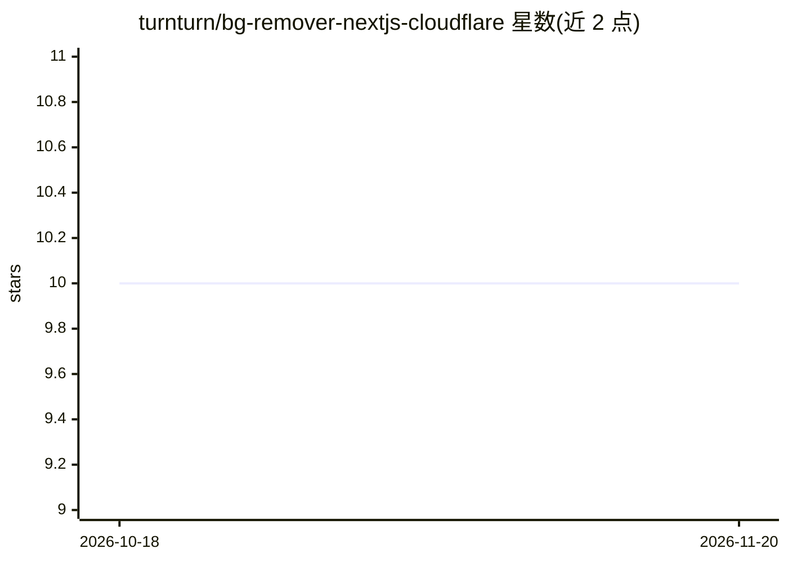

# turnturn/bg-remover-nextjs-cloudflare

⭐ 10 · TypeScript · 推送 2026-04-13 · [GitHub](https://github.com/turnturn/bg-remover-nextjs-cloudflare) · [官网](https://imagesbackgroundremover.com) · 个人维护 · 中文 README

**面向普通用户的 AI 图片背景移除 Web 应用（Next.js + Cloudflare Workers）**

基于 Next.js 16、TypeScript、Tailwind CSS 4 构建的背景移除网站，部署于 Cloudflare Workers 边缘运行时。用户拖拽上传 JPG/PNG/WebP（≤10 MB），由 AI 检测主体并移除背景，可对比查看前后效果并一键下载透明 PNG；图片实时处理、不存储，提供中英文界面。运行需 Node.js 18+ 与 Remove.bg API key，支持 PayPal 支付集成，MIT 许可。

## 筛选速览

| 维度 | 判定 | 备注 |
|---|---|---|
| AI 角色 | `ai-native` | 本体是模型或模型工具 |
| 许可风险 | `none` | — |
| 部署形态 | `None` |  |
| 模型依赖 | — | README 未给出锁定关系 |
| 硬件要求 | — | 无带数字的原话,不猜 |
| 安装摩擦 | `low` | 无编译、无系统依赖或容器化 |
| 成熟度 | — | 结构信号不足 |

## 能力要点

- AI 主体检测与背景移除，输出透明 PNG
- 拖拽上传 + 前后对比滑块 + 一键下载
- Cloudflare Workers 边缘部署，图片实时处理不存储
- 英文与中文双语界面

## 适用场景

- 给商品图或头像快速去掉背景生成透明 PNG
- 手机上即传即得地处理图片
- 自部署一个免登录的背景移除站点

## 场景标签

`图像视频处理` · 领域:感知与多模态

## 证据(README 行号)

> L9: - **🎯 AI Background Removal** — Powered by advanced AI that detects subjects and removes backgrounds in seconds
> L25: 2. **AI processes** and removes the background automatically
> L33: - Cloudflare Workers — Edge deployment

## 星数曲线

2026-10-18 10 → 2026-11-20 10（+0）

---
*卡片 v1 · prompt 1.4 · 生成 2026-11-19 · 置信度 high · 依据 README sha `a0fa8d0a6dcb` · [字段定义](../../DATASET.md)*
