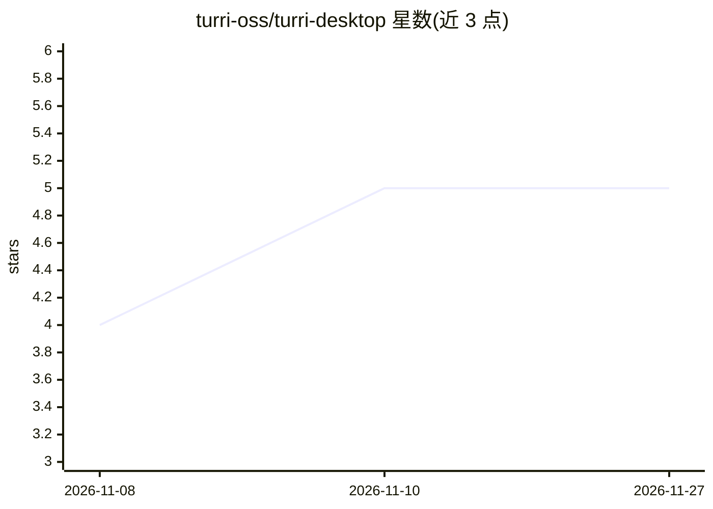

# turri-oss/turri-desktop

⭐ 5 · TypeScript · MIT · 推送 2026-11-21 · [GitHub](https://github.com/turri-oss/turri-desktop) · [官网](https://turri.dev) · 组织维护

**面向开发者的 turri 编码 agent 桌面应用**

turri 的 macOS/Linux 桌面客户端，运行与命令行版 turri 相同的对话与工作循环：以「持久意图」为源真值，意图变更时重新生成代码而非原地修补。界面提供聊天、意图文件视图、pulse 进度面板、内嵌浏览器与终端预览、标准库浏览及后台哨兵检查。应用从发布页下载安装，内置 turri（npm），需 git，Linux 需 bubblewrap 沙箱；模型通过 API key 或登录方式接入多个供应商。

## 筛选速览

| 维度 | 判定 | 备注 |
|---|---|---|
| AI 角色 | `ai-native` | 本体是模型或模型工具 |
| 许可风险 | `permissive` | MIT |
| 部署形态 | `desktop` | 安装包/桌面程序 |
| 模型依赖 | locked-api |  |
| 硬件要求 | — | 无带数字的原话,不猜 |
| 安装摩擦 | `medium` | 含编译或系统依赖之一 |
| 成熟度 | — | 结构信号不足 |

## 能力要点

- 与命令行 turri 相同的对话、工具、斜杠命令、技能与 pulse 循环
- 从持久意图与符合性测试重新生成代码，并提供按模块 regenerate/conform 操作
- 内嵌浏览器与终端预览，后台 sentinel 自动检查完成的 pulse
- 支持 Anthropic、OpenAI、Google、Amazon Bedrock 等模型接入

## 适用场景

- 以桌面应用形式运行 turri 的意图驱动代码生成流程
- 在窗口内查看并调试正在生成的应用
- 为每个项目配置模型供应商并管理多个会话标签页

## 场景标签

`编码 Agent` · 领域:编码与开发

## 证据(README 行号)

> L8: **turri** builds regenerative software: what lasts is the system's intent, and the code is derived from it - cheap t
> L10: **turri desktop** is turri as a desktop app for macOS and Linux. It runs turri's own conversation and work loop - t
> L58: On the welcome screen, **start a new project** - name its folder, choose its models: Anthropic, OpenAI, Google, Ama

## 星数曲线

2026-11-08 4 → 2026-11-27 5（+1）

---
*卡片 v1 · prompt 1.4 · 生成 2026-11-21 · 置信度 mid · 依据 README sha `5a87f9eaba7f` · [字段定义](../../DATASET.md)*
