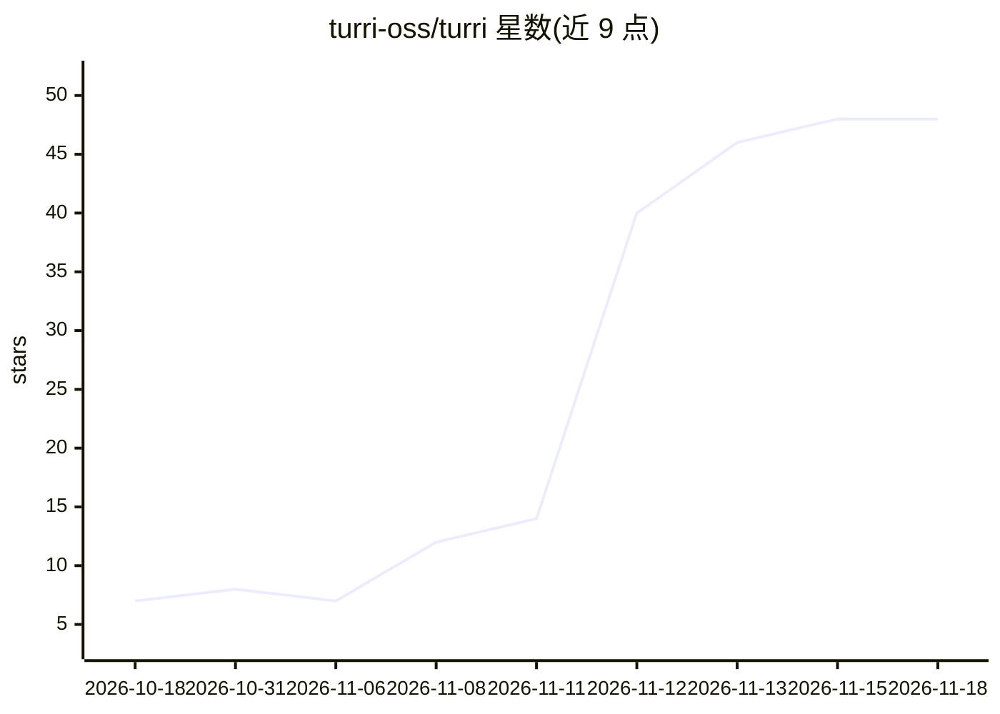

# turri-oss/turri

⭐ 48 · TypeScript · MIT · 推送 2026-11-15 · [GitHub](https://github.com/turri-oss/turri) · [官网](https://turri.dev) · 组织维护

**从系统定义再生代码的编码 agent（CLI 与桌面版）**

基于 pi 构建的命令行编码 agent，主张维护系统定义而非代码：用户描述需求，turri 将其捕获为以 ***plain 编写的结构化系统定义（规格、架构决策、测试），据此生成代码；需求变化时对受影响部分再生而非逐次打补丁，并用独立于 agent 的测试验证实现是否符合定义。模型经 pi 接入多家供应商，harness/coding/judge 三角色可分别配置。运行于 macOS/Linux/WSL，需 Git、Bash 与 Node.js 22.19+，另提供桌面版与 Docker 运行方式。

## 筛选速览

| 维度 | 判定 | 备注 |
|---|---|---|
| AI 角色 | `ai-native` | 本体是模型或模型工具 |
| 许可风险 | `permissive` | MIT |
| 部署形态 | `library` | 以包/库形式分发 |
| 模型依赖 | — | README 未给出锁定关系 |
| 硬件要求 | — | 无带数字的原话,不猜 |
| 安装摩擦 | `low` | 无编译、无系统依赖或容器化 |
| 成熟度 | — | 结构信号不足 |

## 能力要点

- 以 ***plain 系统定义为源头，按需再生代码而非增量补丁
- 三角色模型配置（harness/coding/judge），经 pi 接入多家供应商
- 独立测试验证生成代码，编码 agent 不能修改测试使其通过
- 提供 drift/lineage/regenerate 等命令与无模型解析（turri parse）

## 适用场景

- 用自然语言描述需求并生成可运行应用
- 需求变更后再生受影响代码并验证一致性
- 审查系统定义而非陷入实现细节

## 场景标签

`编码 Agent` `代码生成` · 领域:编码与开发

## 证据(README 行号)

> L8: **turri** is the first coding agent with the power of regenerative software. It gives you back control over engineer
> L50: **turri** captures your intent in \*\*\*plain, generates the code, and validates it against the system definition.

## 星数曲线

2026-10-18 7 → 2026-11-18 48（+41）

---
*卡片 v1 · prompt 1.4 · 生成 2026-11-18 · 置信度 high · 依据 README sha `a59fc33fe27c` · [字段定义](../../DATASET.md)*
