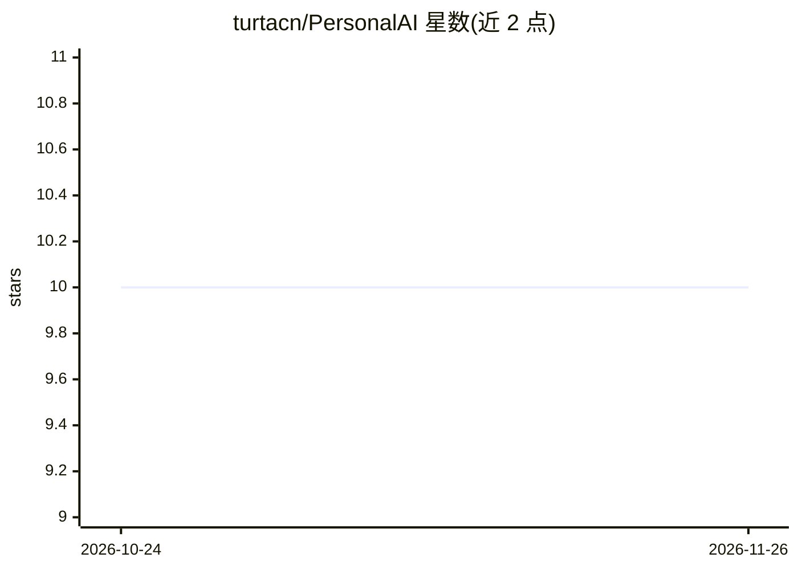

# turtacn/PersonalAI

⭐ 10 · Apache-2.0 · 推送 2026-01-30 · [GitHub](https://github.com/turtacn/PersonalAI) · 组织维护 · 中文 README

**面向研发团队的生成式 AI 研发全流程实践指南**

定位为研发团队使用 LLM、Agent 与 MCP 的实践指南，提出"产品研发GPT三级火箭"流程（原型、开发、知识产权草案），并给出配套开源项目索引（31 个，覆盖 AI Agent 框架、模型服务引擎、AI 运维助手等）与企业案例分析、AI 架构设计提示。内容以指南文档与提示词模板、工作流、工具脚本集合形式组织，无安装与运行说明；项目标注 W.I.P，面向技术负责人、工程师、产品经理与架构师。

## 筛选速览

| 维度 | 判定 | 备注 |
|---|---|---|
| AI 角色 | `ai-knowledge` | 知识聚合/清单类 |
| 许可风险 | `permissive` | Apache-2.0 |
| 部署形态 | `None` |  |
| 模型依赖 | — | README 未给出锁定关系 |
| 硬件要求 | — | 无带数字的原话,不猜 |
| 安装摩擦 | `low` | 无编译、无系统依赖或容器化 |
| 成熟度 | `idea` | |

## 能力要点

- 提出 PrototypeGPT→DevelopGPT→IPRGPT 三阶段研发流程
- 提供覆盖研发各阶段的提示词模板库与标准化工作流
- 维护 31 个相关开源项目的索引表

## 适用场景

- 为研发团队落地 AI 辅助开发流程找方法参考
- 从需求到知识产权保护阶段套用现成提示词模板
- 在同一维护者的相关开源工具中挑选配套组件

## 场景标签

`提示工程` `教程课程` · 领域:Agent 开发

## 证据(README 行号)

> L9:  人工智能赋能研发全过程的实践指南
> L14: **PersonalAI** 项目致力于构建一个全面的武器库，聚焦于"先用AI，先进起来"的理念，为研发团队提供在云原生、中台、平台化等领域充分利用人工智能技术的实践指南。该项目整合了大型语言模型(LLM)、智能体(Agent)和
> L64: - **全面的方法论体系**：提供从需求分析到知识产权保护的完整AI应用方法论

## 星数曲线

2026-10-24 10 → 2026-11-26 10（+0）

---
*卡片 v1 · prompt 1.4 · 生成 2026-11-19 · 置信度 high · 依据 README sha `562a8efde911` · [字段定义](../../DATASET.md)*
