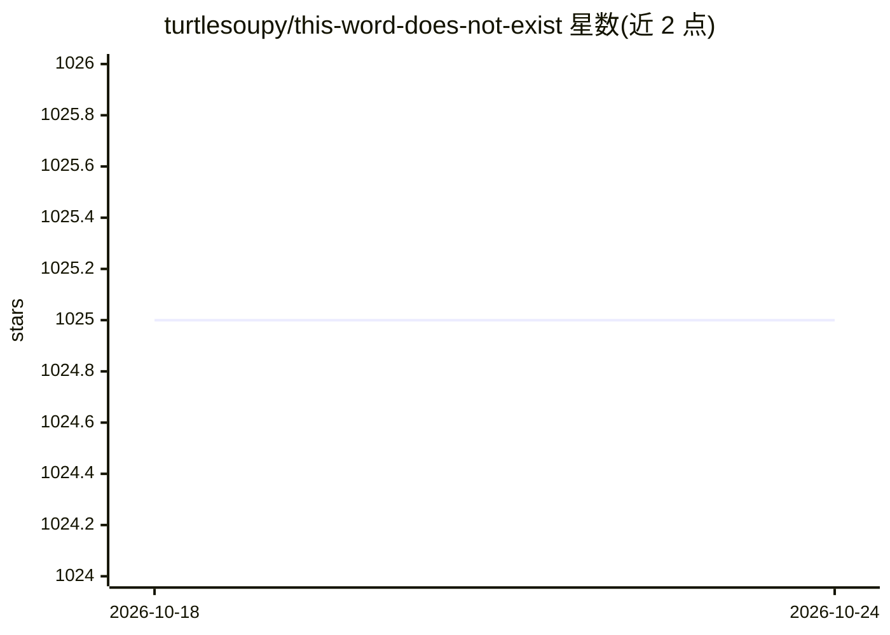

# turtlesoupy/this-word-does-not-exist

⭐ 1,025 · Python · MIT · 推送 2026-06-17 · [GitHub](https://github.com/turtlesoupy/this-word-does-not-exist) · [官网](https://www.thisworddoesnotexist.com) · 个人维护

**训练 GPT-2 变体从零生成虚构单词、定义与例句**

基于 GPT-2 变体的自然语言生成项目：提供从零训练生成虚构单词、定义和例句的代码，包含正向模型（词→定义）与逆向模型（定义→词），并提供可下载的预训练模型文件，可在 CPU 上通过 WordGenerator 类运行推理。训练需自行提取词典数据（Apple 词典或 Urban Dictionary），附带训练脚本与网站运行说明，另有在线 demo 与 Twitter 机器人。

## 筛选速览

| 维度 | 判定 | 备注 |
|---|---|---|
| AI 角色 | `ai-native` | 本体是模型或模型工具 |
| 许可风险 | `permissive` | MIT |
| 部署形态 | `library` | 以包/库形式分发 |
| 模型依赖 | — | README 未给出锁定关系 |
| 硬件要求 | — | 无带数字的原话,不猜 |
| 安装摩擦 | `low` | 无编译、无系统依赖或容器化 |
| 成熟度 | — | 结构信号不足 |

## 能力要点

- 训练 GPT-2 变体生成虚构单词、定义与例句
- 提供正向（词→定义）与逆向（定义→词）预训练模型下载
- 支持 CPU 设备运行推理
- 包含从 Apple 词典与 Urban Dictionary 提取训练数据的代码

## 适用场景

- 生成虚构单词及配套定义用于创意写作或娱乐
- 用自有词典数据训练自定义的单词生成模型
- 研究逆向词典（定义→词）的建模方法

## 场景标签

 · 领域:自然语言生成

## 证据(README 行号)

> L4: This is a project allows
> L5: people to train a variant of GPT-2 that makes
> L6: up words, definitions and examples from scratch.

## 星数曲线

2026-10-18 1,025 → 2026-10-24 1,025（+0）

---
*卡片 v1 · prompt 1.4 · 生成 2026-10-21 · 置信度 mid · 依据 README sha `465818a4f3a7` · [字段定义](../../DATASET.md)*
