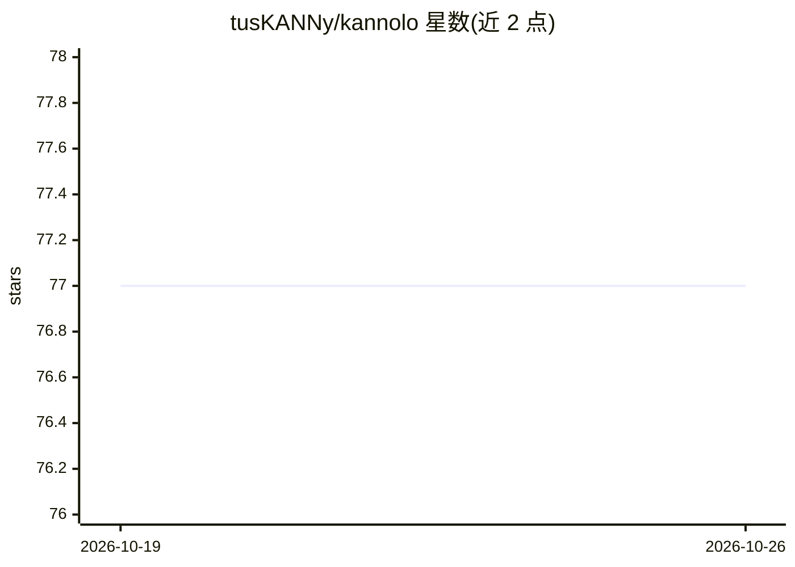

# tusKANNy/kannolo

⭐ 77 · Rust · MIT · 推送 2026-10-23 · [GitHub](https://github.com/tusKANNy/kannolo) · 组织维护

**面向研究的 Rust 近似最近邻检索库，含 Python 绑定**

用 Rust 编写的近似最近邻（ANN）检索库，面向需要原型化新 ANN 算法与数据结构的研究者。实现 HNSW 图索引与乘积量化（PQ），支持稠密与稀疏嵌入，multivec 特性下提供多向量重排索引（SparseMultivecRerankIndex 等）。通过 maturin/PyO3 提供 Python 包（pip 安装预编译 wheel），Rust 侧提供 cargo 构建与可选 CLI 二进制（hnsw_build/hnsw_search/ivf 等）。附 ECIR 2025 论文，源码采用引用许可（使用即同意引用论文）；多向量重排功能需从源码构建。

## 筛选速览

| 维度 | 判定 | 备注 |
|---|---|---|
| AI 角色 | `ai-ecosystem` | LLM/agent 周边工具 |
| 许可风险 | `permissive` | MIT |
| 部署形态 | `library` | 以包/库形式分发 |
| 模型依赖 | — | README 未给出锁定关系 |
| 硬件要求 | — | 无带数字的原话,不猜 |
| 安装摩擦 | `medium` | 含编译或系统依赖之一 |
| 成熟度 | — | 结构信号不足 |

## 能力要点

- 实现 HNSW 图索引与乘积量化（PQ）
- 支持稠密与稀疏嵌入，multivec 特性提供多向量两阶段重排索引
- Python wheel（pip install kannolo）与 Rust crate 双形态发布
- 可选 CLI 二进制：hnsw_build/hnsw_search/ivf_build/ivf_search 等

## 适用场景

- 为检索系统提供稠密/稀疏向量索引与搜索
- 原型化新的 ANN 算法与数据结构并做实验
- 复现论文实验结果或用于自定义向量集合

## 场景标签

`向量数据库` · 领域:知识与检索

## 证据(README 行号)

> L3: kANNolo is a research-oriented library for Approximate Nearest Neighbors (ANN) search written in Rust 🦀. It is expli
> L10: pip install kannolo

## 星数曲线

2026-10-19 77 → 2026-10-26 77（+0）

---
*卡片 v1 · prompt 1.4 · 生成 2026-10-24 · 置信度 high · 依据 README sha `3891e3978a9c` · [字段定义](../../DATASET.md)*
