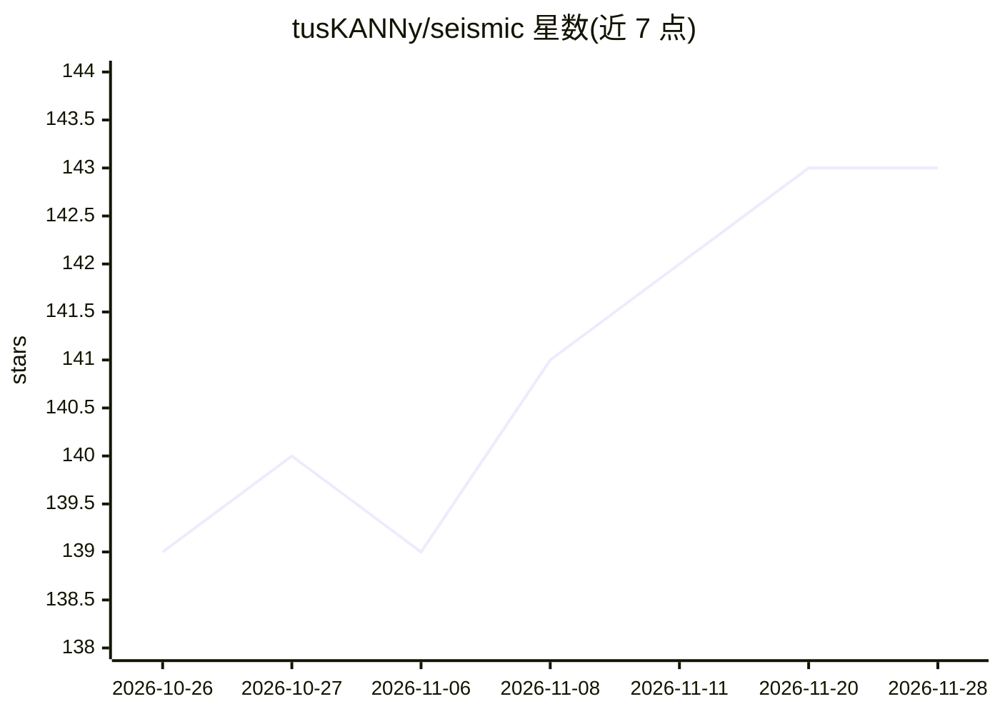

# tusKANNy/seismic

⭐ 143 · Rust · MIT · 推送 2026-11-27 · [GitHub](https://github.com/tusKANNy/seismic) · 组织维护

**面向学习型稀疏向量的检索引擎：索引与近精确召回**

以 Rust 编写并提供 Python 绑定的稀疏向量搜索引擎，对稀疏向量集合建立索引并以微秒级延迟返回近似检索结果。提供标准索引、压缩索引（DotPacking8）与大词表索引（>65K 词元）三种变体，支持在索引中加载文档原文以配合 RAG 管道、多线程批量查询，并附带 Jupyter 示例与预优化配置。安装依赖 Python>=3.8；源码编译需 Rust 工具链。采用 MIT 许可并附加引用许可条款。

## 筛选速览

| 维度 | 判定 | 备注 |
|---|---|---|
| AI 角色 | `ai-native` | 本体是模型或模型工具 |
| 许可风险 | `permissive` | MIT |
| 部署形态 | `library` | 以包/库形式分发 |
| 模型依赖 | — | README 未给出锁定关系 |
| 硬件要求 | — | 无带数字的原话,不猜 |
| 安装摩擦 | `low` | 无编译、无系统依赖或容器化 |
| 成熟度 | — | 结构信号不足 |

## 能力要点

- 三种索引变体：标准、压缩（DotPacking8）、大词表（LV）
- RAG-ready：可随检索结果返回文档原文
- Python 与 Rust 双 API（pip 包 pyseismic-lsr / cargo add seismic）
- 多线程 batch_search 批量查询

## 适用场景

- 为学习型稀疏表示（如 SPLADE 编码向量）构建检索索引
- 在 RAG 管道中作为稀疏检索组件返回文档内容
- 在 MS MARCO 等数据集上复现稀疏检索实验

## 场景标签

`向量数据库` `语义搜索` · 领域:知识与检索

## 证据(README 行号)

> L3: Seismic is a fast and lightweight search engine for learned sparse embeddings, written in Rust with Python bindings.
> L48: - **Multiple index variants** — Standard (`SeismicIndex`), compressed (`SeismicIndexDotPacking8`), and large vocabu

## 星数曲线

2026-10-26 139 → 2026-11-28 143（+4）

---
*卡片 v1 · prompt 1.4 · 生成 2026-11-28 · 置信度 high · 依据 README sha `7c62dc7af331` · [字段定义](../../DATASET.md)*
