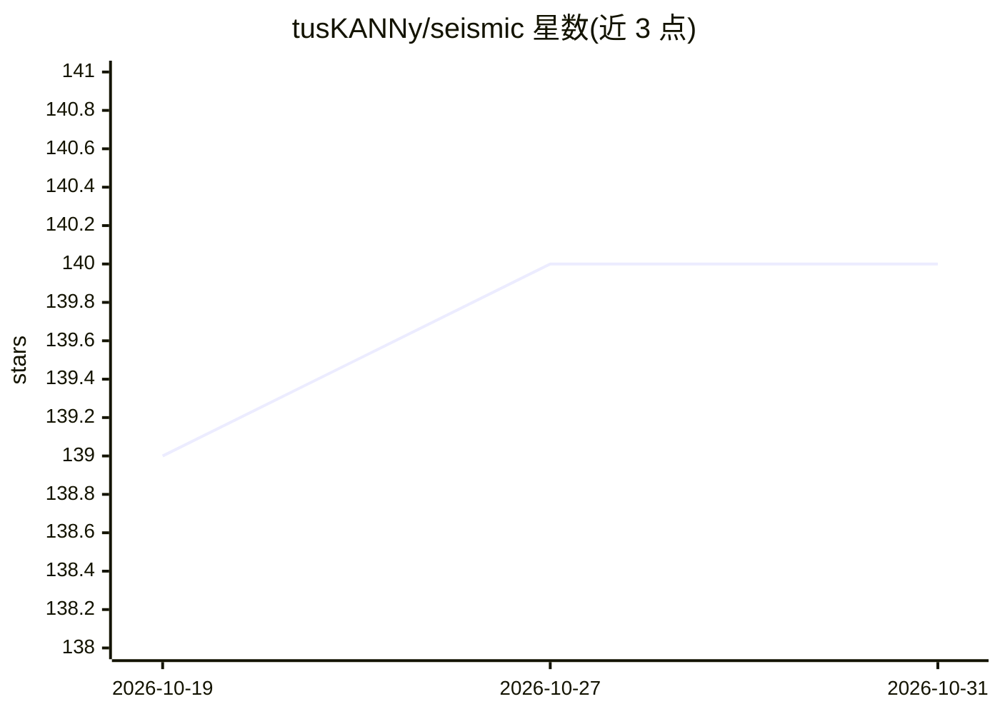

# tusKANNy/seismic

⭐ 140 · Rust · MIT · 推送 2026-10-26 · [GitHub](https://github.com/tusKANNy/seismic) · 组织维护

**面向学习型稀疏嵌入的近似稀疏向量检索库（Rust + Python）**

Seismic 是用 Rust 编写、提供 Python 绑定的搜索引擎，针对学习型稀疏嵌入（learned sparse embeddings）建立倒排索引并结合 k-NN 图做近似检索，检索延迟为微秒级。输入为 jsonl 格式的稀疏向量集合（token 到分数的映射），支持标准、压缩（DotVByte）与超大词表三种索引变体，提供多线程批量检索，可配合 RAG 流水线返回文档原文。安装通过 pip 安装 pyseismic-lsr，或用 Rust 工具链从源码编译以获得硬件特定优化。附带多个数据集的预优化配置与 SIGIR/CIKM/ECIR 论文，采用引用许可：使用需引用其论文。

## 筛选速览

| 维度 | 判定 | 备注 |
|---|---|---|
| AI 角色 | `ai-ecosystem` | LLM/agent 周边工具 |
| 许可风险 | `permissive` | MIT |
| 部署形态 | `library` | 以包/库形式分发 |
| 模型依赖 | — | README 未给出锁定关系 |
| 硬件要求 | — | 无带数字的原话,不猜 |
| 安装摩擦 | `low` | 无编译、无系统依赖或容器化 |
| 成熟度 | — | 结构信号不足 |

## 能力要点

- 针对学习型稀疏嵌入的近似检索，倒排索引 + k-NN 图结构
- 三种索引变体：标准 / DotVByte 压缩 / 超大词表（>65K token）
- 多线程批量检索与 RAG-ready 文档内容返回
- Python（pyseismic-lsr）与 Rust（cargo add seismic）双 API

## 适用场景

- 为稀疏检索模型（如 splade）建立的向量集合做低延迟 ANN 检索
- 在大规模文档集合上做 RAG 检索并返回文档原文
- 复现论文实验或按预优化配置跑检索评测

## 场景标签

`向量数据库` · 领域:知识与检索

## 证据(README 行号)

> L3: Seismic is a fast and lightweight search engine for learned sparse embeddings, written in Rust with Python bindings.
> L50: - **Python & Rust APIs** — Use from Python via `pyseismic-lsr` or integrate directly in Rust via `cargo add seismic

## 星数曲线

2026-10-19 139 → 2026-10-31 140（+1）

---
*卡片 v1 · prompt 1.4 · 生成 2026-10-22 · 置信度 high · 依据 README sha `f0b003ec1cb9` · [字段定义](../../DATASET.md)*
